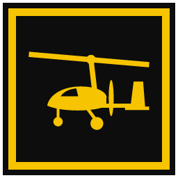
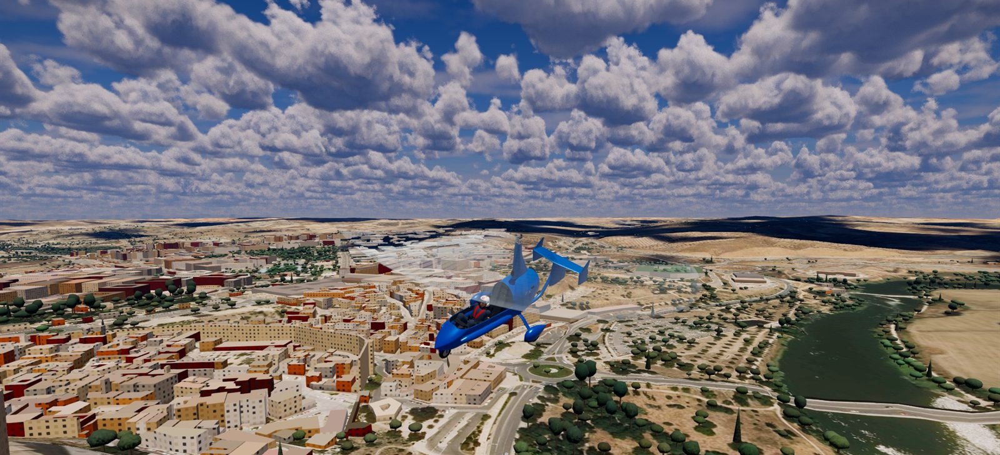
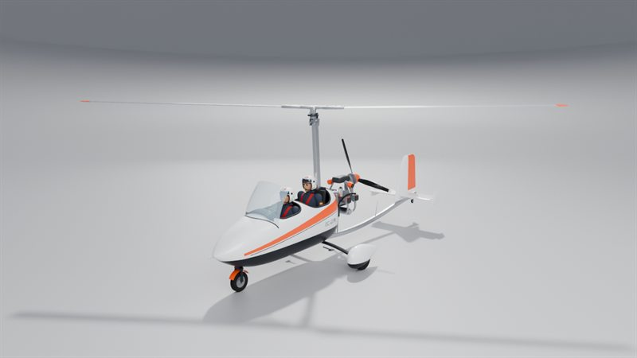

  

<h1 align="center">Autogiro</h1>

  <b>Español</b> · <a href="#english"><b>English</b></a>

  <b>Vuela un autogiro sobre el mundo real</b> 
  Física de autogiro de verdad · relieve y ortofotos del IGN · edificios y árboles en 3D · multijugador

  

  Gratis · Windows 10 y 11 · en español e inglés · se actualiza solo ·
  <a href="https://github.com/Marius-Romanus/autogiro/releases">novedades</a>

  

  Hecho con ❤️ por <a href="https://creativecode.es/"><b>Mario</b></a> · más proyectos en
  <a href="https://creativecode.es/"><b>creativecode.es</b></a> ·
  <a href="https://ko-fi.com/mario_creativecode">☕ invítame a un café</a>

---

Un simulador para quien quiera saber cómo se vuela un autogiro de verdad. Despega desde tu aeródromo, sobrevuela tu pueblo o la sierra que conoces y aprende por qué un
autogiro no se pilota como un avión ni como un helicóptero.

- **Física de autogiro, no de avión con hélice arriba.** El rotor gira libre en autorrotación,
  hay que prerrotarlo para despegar, sus vueltas dependen de la carga y avisa si bate las palas o
  si lo descargas. Las prestaciones se han contrastado con datos reales de cada aparato.
- **El mundo real.** En toda España vuelas sobre la ortofoto del PNOA y el relieve de 5 m del IGN,
  con los edificios de OpenStreetMap y los árboles sacados de la propia foto. Con una clave de Google
  puedes usar también el 3D fotorrealista de Google en cualquier parte del planeta.
- **Cielo de verdad.** Atmósfera física, nubes volumétricas con su sombra, la hora y la fecha que
  quieras, viento y turbulencia, y vuelo nocturno con luces de navegación y de aterrizaje.
- **Aeródromos y aeropuertos.** Casarrubios (LEMT), Cuatro Vientos, Barajas, El Prat, Palma,
  Málaga, Sevilla, Valencia, Bilbao, Tenerife Norte y Gran Canaria, con salida en cabecera o en
  final, y lugares para pasear: Madrid, Toledo, El Escorial, Segovia, Gredos, Montserrat, Ordesa…
  o las coordenadas que quieras.
- **Con amigos.** Crea una sala, pasa el código y volad juntos hasta 8 pilotos, con chat.
- **Accidentes realistas.** Si te la pegas, el aparato se rompe por piezas según los golpes.
- **Teclado, ratón, mando o joystick/HOTAS**, con una ayuda al pilotaje opcional para volar con
  teclado sin pelearte con el fugoide.
- **En español e inglés.** El juego se pone en el idioma de tu Windows y se cambia en el menú
  (botones `ES` / `EN`, arriba).

<table>
  <tr>
    <td width="50%"></td>
    <td width="50%"></td>
  </tr>
  <tr>
    <td align="center">Relojes de rotor, motor, velocidad y variómetro</td>
    <td align="center">Edificios reales en 3D, con sus alturas</td>
  </tr>
</table>

## Los aparatos

<table>
  <tr>
    <td width="50%"></td>
    <td width="50%"></td>
  </tr>
  <tr>
    <td><b>ELA 07 Cougar</b> · tándem abierto de ELA Aviación (Córdoba), Rotax 914 turbo.</td>
    <td><b>ELA 10 Eclipse</b> · cabina cerrada y estilizada, el más rápido, Rotax 914 turbo.</td>
  </tr>
  <tr>
    <td width="50%"></td>
    <td width="50%"></td>
  </tr>
  <tr>
    <td><b>Biplaza tándem</b> · el clásico de escuela tipo MTOsport, Rotax 912.</td>
    <td><b>Cierva C.30A (1934)</b> · homenaje a Juan de la Cierva, con hélice delante, rotor
    tripala, radial de 7 cilindros y rueda de cola. Se vuela como entonces.</td>
  </tr>
</table>

Todos se pueden llevar solos o con pasajero, y cada uno tiene sus pesos, su motor, su rotor y su
cola: no vuelan igual.

## Instalar

1. **[Descarga el instalador](https://github.com/Marius-Romanus/autogiro/releases/latest/download/Autogiro-Setup.exe)**
   (unos 20 MB) y ábrelo.
2. La primera vez Windows puede avisar con *«Windows protegió su PC»* porque el instalador no está
   firmado: pulsa **Más información → Ejecutar de todas formas**.
3. Se instala solo, sin permisos de administrador, y crea el acceso directo en el escritorio.

Cuando salga una versión nueva, el juego te lo dirá al abrirlo y se actualizará con un clic.

**Qué necesitas:** Windows 10 u 11, conexión a Internet (el paisaje se descarga mientras vuelas) y,
mejor, una tarjeta gráfica dedicada. El juego usa siempre la gráfica potente del portátil y elige
la calidad solo; puedes cambiarla en el menú (*Gráficos y mandos → Calidad*). **F11** pone la
pantalla completa.

  

## Tu primer vuelo

1. Quita el **freno de rotor** (`B`) y suelta el **freno de parking** (`L`).
2. **Palanca adelante** (mantén `W`) y **gas al 40 %** (`R`), unas 3000 rpm de motor.
3. Mantén el **prerrotador** (`P`) hasta que el rotor llegue a **200–220 rpm**.
4. A la vez: suelta el prerrotador, **palanca toda atrás** (mantén `S`) y **gas a fondo**.
5. El rotor se embala con la velocidad y se va al aire a unos **70–80 km/h**. Entonces cede
   palanca para acelerar a 90–100 km/h pegado al suelo, y sube.

Para tomar: aproximación a 80–90 km/h y, a unos 6–8 m del suelo, tira de palanca y mantenla
(sale el aviso «RECOGIDA»). Con `H` tienes la ayuda en pantalla en cualquier momento.

## Cómo se vuela (y por qué es distinto)

- **Palanca = velocidad, gas = altura.** La palanca inclina el disco del rotor; el gas te sube o te baja.
- **Sin motor no pasa nada**: el rotor sigue girando y planeas a ~100 km/h bajando unos 6 m/s.
  Con la palanca toda atrás bajas casi en vertical, estable pero demasiado deprisa para tomar.
- **Batimiento de palas:** correr deprisa con pocas vueltas de rotor hace que la pala que avanza
  bata contra los topes. Accidente.
- **Baja carga:** empujar la palanca de golpe descarga el rotor, pierde vueltas y puedes perder el
  control. Mantén siempre carga positiva.
- Vigila el **tacómetro del rotor** (amarillo = prerrotación, verde = vuelo) y, en cabina, el
  **hilo de guiñada** del parabrisas.

## Mandos

| Tecla | Acción |
|---|---|
| `W` `S` / `↑` `↓` | Palanca adelante / atrás. **Se queda donde la dejas**; `Inicio` la centra |
| `A` `D` / `←` `→` | Palanca izquierda / derecha |
| `Q` `E` | Pedales (timón y rueda de morro) |
| `R` `F`, `1`…`0` | Gas |
| `T` `G` | Compensador |
| `P` (mantener) | Prerrotador |
| `B` | Freno de rotor |
| `Espacio` / `L` | Frenos / freno de parking |
| `M` | Arrancar o parar el motor |
| `O` | Luces |
| `J` | Guía de pilotaje lateral (despegue, vuelo y aterrizaje); también con el botón «Guía» |
| `C` / `V` | Cambiar de cámara / mirar atrás |
| Ratón (arrastrar, rueda) | Mirar, zoom |
| `K` | Ratón como palanca |
| `Intro` | Chat (en multijugador) |
| `I` / `H` / `Esc` / `Retroceso` | Instrumentos / ayuda / menú / reiniciar |
| `F11` | Pantalla completa |

**Mando tipo Xbox:** stick izquierdo = palanca, stick derecho = pedales, gatillos = gas,
A = prerrotador, B = frenos. **Joystick o HOTAS:** los ejes se configuran en el menú y se ven en vivo.

La **ayuda al pilotaje** (activada de serie) hace con la mano lo que un piloto hace sin pensar:
amortigua las oscilaciones de cabeceo, nivela las alas y modera la recogida al tomar. No cambia la
física. Desactívala en el menú para volar al 100 % a mano.

## Volar con amigos

En el menú, **Multijugador**: escribe tu nombre y pulsa **Crear sala**. Te da un código de
4 letras; tus amigos lo escriben y pulsan **Unirse**. Quien crea la sala elige el lugar, la hora y
el tiempo para todos, y cada uno su aparato.

- **En la misma wifi** entran directamente con la dirección que les indica el juego.
- **Por Internet**, el juego te explica paso a paso cómo abrir un túnel gratuito de Cloudflare
  (*Multijugador → Jugar por Internet*). Tus amigos pueden entrar incluso sin instalar nada, desde
  Chrome o Edge.

## Escenario

| Modo | Qué ves | Necesita |
|---|---|---|
| **Ortofoto + relieve** (de serie) | En España, ortofoto PNOA y relieve de 5 m del IGN, edificios 3D de OpenStreetMap y árboles 3D. Fuera de España, imágenes de satélite de Esri. | Nada |
| **Fotorrealista 3D de Google** | Ciudades, árboles y montañas en 3D fotorrealista en todo el mundo. | Una clave gratuita de Google |

<b>Cómo conseguir la clave de Google</b>

1. Entra en <https://console.cloud.google.com/> y crea un proyecto.
2. Activa la facturación (hay una cuota gratuita mensual generosa).
3. *APIs y servicios → Biblioteca* → habilita **Map Tiles API**.
4. *Credenciales → Crear credenciales → Clave de API*.
5. Pégala en el menú del juego. Se guarda solo en tu ordenador.

## Créditos

Creado por **Mario** · blog y otros proyectos en [creativecode.es](https://creativecode.es/) ·
si te gusta, [invítame a un café en Ko-fi](https://ko-fi.com/mario_creativecode) ☕

- Ortofoto PNOA y MDT05 © Instituto Geográfico Nacional ([scne.es](https://www.scne.es)), CC BY 4.0 ·
  imágenes Esri World Imagery · relieve global Mapzen / AWS Terrain Tiles · Google Photorealistic 3D Tiles © Google.
- Edificios © colaboradores de OpenStreetMap (ODbL), teselas de [OpenFreeMap](https://openfreemap.org) / OpenMapTiles.
- [3d-tiles-renderer](https://github.com/NASA-AMMOS/3DTilesRendererJS) (NASA-AMMOS),
  [three-geospatial](https://github.com/takram-design-engineering/three-geospatial) (takram) para
  atmósfera y nubes, [Three.js](https://threejs.org), [Rapier](https://rapier.rs) y [Tauri](https://tauri.app).
- Cierva C.30A: plano de tres vistas de *Flight* (1934) reproducido en la
  [NACA Aircraft Circular 196](https://ntrs.nasa.gov/citations/19930090361), datos de vuelo de los
  ensayos de la RAE (ARC R&M 1859 y 1727) y decoración de la réplica del Museo del Aire de Madrid.

## Licencia

Autogiro es gratis para jugar, estudiar y modificar con cualquier fin **no comercial**: uso personal,
aficionados, clubes, escuelas y asociaciones sin ánimo de lucro. **No se permite venderlo ni usarlo para
ganar dinero** (tampoco versiones modificadas) sin permiso del autor. Si lo compartes o publicas una versión
modificada, tiene que ir con la licencia y el aviso de autoría: *Copyright (c) 2026 Mario (creativecode.es)*.
Texto completo en [LICENSE](LICENSE) ([PolyForm Noncommercial 1.0.0](https://polyformproject.org/licenses/noncommercial/1.0.0)).
Para un uso comercial, escríbeme a través de [creativecode.es](https://creativecode.es/).

---

<h1 align="center">Autogiro · English</h1>

  <a href="#espanol"><b>Español</b></a> · <b>English</b>

  <b>Fly a gyrocopter over the real world</b> 
  Real autogyro physics · Spanish IGN terrain and orthophotos · 3D buildings and trees · multiplayer

  

  Free · Windows 10 and 11 · in English and Spanish · updates itself ·
  <a href="https://github.com/Marius-Romanus/autogiro/releases">release notes</a> (in Spanish)

  Made with ❤️ by <a href="https://creativecode.es/"><b>Mario</b></a> · more projects at
  <a href="https://creativecode.es/"><b>creativecode.es</b></a> ·
  <a href="https://ko-fi.com/mario_creativecode">☕ buy me a coffee</a>

A simulator for anyone who wants to know how a real autogyro (gyrocopter, gyroplane) flies. Take off
from your airfield, fly over your town or the mountains you know, and learn why a gyro is flown neither
like an aeroplane nor like a helicopter.

- **Gyro physics, not an aeroplane with a propeller on top.** The rotor spins freely in
  autorotation, you have to pre-rotate it to take off, its RPM depends on the load, and it warns you
  about blade flapping and low-g. Performance has been checked against real data for each aircraft.
- **The real world.** All over Spain you fly over the IGN's PNOA orthophotos and 5 m terrain model,
  with OpenStreetMap buildings and trees detected in the photo itself. Outside Spain you get Esri
  satellite imagery, and with a Google key you can use Google's photorealistic 3D anywhere on Earth.
- **A real sky.** Physical atmosphere, volumetric clouds with their shadows, any time and date,
  wind and turbulence, and night flying with navigation and landing lights.
- **Airfields and airports.** Casarrubios (LEMT), Cuatro Vientos, Madrid-Barajas, Barcelona,
  Palma, Málaga, Seville, Valencia, Bilbao, Tenerife North and Gran Canaria, starting on the runway or
  on final, plus scenic spots: Madrid, Toledo, El Escorial, Segovia, Gredos, Montserrat, Ordesa…
  or any coordinates you like.
- **With friends.** Create a room, share the code and fly together, up to 8 pilots, with chat.
- **Realistic crashes.** If you crash, the aircraft breaks apart piece by piece depending on the impacts.
- **Keyboard, mouse, gamepad or joystick/HOTAS**, with an optional flying assist so you can fly with
  the keyboard without fighting the phugoid.
- **In English and Spanish.** The game follows your Windows language, and you can switch it in the
  menu (`ES` / `EN` buttons at the top).

<table>
  <tr>
    <td width="50%"></td>
    <td width="50%"></td>
  </tr>
  <tr>
    <td align="center">Rotor, engine, airspeed and vertical speed gauges</td>
    <td align="center">Real buildings in 3D, with their heights</td>
  </tr>
</table>

## The aircraft

<table>
  <tr>
    <td width="50%"></td>
    <td width="50%"></td>
  </tr>
  <tr>
    <td><b>ELA 07 Cougar</b> · open tandem by ELA Aviación (Córdoba, Spain), Rotax 914 turbo.</td>
    <td><b>ELA 10 Eclipse</b> · sleek enclosed cabin, the fastest one, Rotax 914 turbo.</td>
  </tr>
  <tr>
    <td width="50%"></td>
    <td width="50%"></td>
  </tr>
  <tr>
    <td><b>Two-seat tandem</b> · the classic MTOsport-style trainer, Rotax 912.</td>
    <td><b>Cierva C.30A (1934)</b> · a tribute to Juan de la Cierva, the inventor of the autogyro:
    tractor propeller, three-blade rotor, 7-cylinder radial engine and tailwheel. You fly it the way
    it was flown back then.</td>
  </tr>
</table>

All of them can be flown solo or with a passenger, and each one has its own weights, engine, rotor
and tail: they don't fly the same.

## Install

1. **[Download the installer](https://github.com/Marius-Romanus/autogiro/releases/latest/download/Autogiro-Setup.exe)**
   (about 20 MB) and run it. It shows up in English or Spanish depending on your Windows.
2. The first time, Windows may show *“Windows protected your PC”* because the installer isn't signed:
   click **More info → Run anyway**.
3. It installs by itself, without administrator rights, and adds a shortcut to your desktop.

When a new version comes out, the game tells you when you open it and updates with one click.

**You need:** Windows 10 or 11, an Internet connection (the scenery is downloaded as you fly) and,
ideally, a dedicated graphics card. The game always uses the laptop's powerful GPU and picks the
quality by itself; you can change it in the menu (*Graphics & controls → Quality*). **F11** toggles
full screen.

## Your first flight

1. Release the **rotor brake** (`B`) and the **parking brake** (`L`).
2. **Stick forward** (hold `W`) and **40 % throttle** (`R`), about 3000 engine rpm.
3. Hold the **pre-rotator** (`P`) until the rotor reaches **200–220 rpm**.
4. All at once: let go of the pre-rotator, **full back stick** (hold `S`) and **full throttle**.
5. The rotor speeds up as you gain speed and you lift off at about **70–80 km/h**. Then ease the
   stick forward to accelerate to 90–100 km/h close to the ground, and climb.

To land: approach at 80–90 km/h and, about 6–8 m above the ground, pull the stick back and hold it
(the “FLARE” warning appears). Press `H` for the on-screen help at any time.

## How to fly a gyro (and why it's different)

- **Stick = speed, throttle = height.** The stick tilts the rotor disc; the throttle makes you
  climb or descend.
- **No engine, no panic:** the rotor keeps turning and you glide at ~100 km/h, sinking about 6 m/s.
  With full back stick you come down almost vertically: stable, but too fast to land.
- **Blade flapping:** taxiing fast with low rotor RPM makes the advancing blade hit its stops. Crash.
- **Low-g:** pushing the stick forward abruptly unloads the rotor, it loses RPM and you can lose
  control. Always keep positive load.
- Keep an eye on the **rotor tachometer** (yellow = pre-rotation, green = flight) and, in the
  cockpit, on the **yaw string** on the windscreen.

## Controls

| Key | Action |
|---|---|
| `W` `S` / `↑` `↓` | Stick forward / back. **It stays where you leave it**; `Home` centres it |
| `A` `D` / `←` `→` | Stick left / right |
| `Q` `E` | Pedals (rudder and nose wheel) |
| `R` `F`, `1`…`0` | Throttle |
| `T` `G` | Trim |
| `P` (hold) | Pre-rotator |
| `B` | Rotor brake |
| `Space` / `L` | Brakes / parking brake |
| `M` | Start or stop the engine |
| `O` | Lights |
| `J` | Side flying guide (takeoff, flight and landing); also the «Guide» button |
| `C` / `V` | Change camera / look back |
| Mouse (drag, wheel) | Look around, zoom |
| `K` | Mouse as stick |
| `Enter` | Chat (multiplayer) |
| `I` / `H` / `Esc` / `Backspace` | Instruments / help / menu / restart |
| `F11` | Full screen |

**Xbox-style gamepad:** left stick = cyclic stick, right stick = pedals, triggers = throttle,
A = pre-rotator, B = brakes. **Joystick or HOTAS:** the axes are set up in the menu and shown live.

The **flying assist** (on by default) does with its hands what a pilot does without thinking: it
damps the pitch oscillations, levels the wings and moderates the flare when landing. It doesn't
change the physics. Turn it off in the menu to fly 100 % by hand.

## Flying with friends

In the menu, **Multiplayer**: type your name and click **Create room**. You get a 4-letter code;
your friends type it and click **Join**. Whoever creates the room picks the place, time and weather
for everyone, and each pilot picks their own aircraft.

- **On the same Wi-Fi** they join straight away with the address the game shows them.
- **Over the Internet**, the game explains step by step how to open a free Cloudflare tunnel
  (*Multiplayer → Play over the Internet*). Your friends can even join without installing anything,
  from Chrome or Edge.

## Scenery

| Mode | What you see | Needs |
|---|---|---|
| **Orthophoto + terrain** (default) | In Spain, PNOA orthophotos and the IGN 5 m terrain model, OpenStreetMap buildings in 3D and 3D trees. Outside Spain, Esri satellite imagery. | Nothing |
| **Google Photorealistic 3D** | Photorealistic 3D cities, trees and mountains all over the world. | A free Google key |

<b>How to get the Google key</b>

1. Go to <https://console.cloud.google.com/> and create a project.
2. Enable billing (there is a generous free monthly quota).
3. *APIs & Services → Library* → enable the **Map Tiles API**.
4. *Credentials → Create credentials → API key*.
5. Paste it into the game menu. It is only stored on your computer.

## Credits

Created by **Mario** · blog and other projects at [creativecode.es](https://creativecode.es/) ·
if you like it, [buy me a coffee on Ko-fi](https://ko-fi.com/mario_creativecode) ☕

- PNOA orthophoto and MDT05 © Instituto Geográfico Nacional ([scne.es](https://www.scne.es)), CC BY 4.0 ·
  Esri World Imagery · global terrain Mapzen / AWS Terrain Tiles · Google Photorealistic 3D Tiles © Google.
- Buildings © OpenStreetMap contributors (ODbL), tiles by [OpenFreeMap](https://openfreemap.org) / OpenMapTiles.
- [3d-tiles-renderer](https://github.com/NASA-AMMOS/3DTilesRendererJS) (NASA-AMMOS),
  [three-geospatial](https://github.com/takram-design-engineering/three-geospatial) (takram) for
  atmosphere and clouds, [Three.js](https://threejs.org), [Rapier](https://rapier.rs) and [Tauri](https://tauri.app).
- Cierva C.30A: three-view drawing from *Flight* (1934) reproduced in
  [NACA Aircraft Circular 196](https://ntrs.nasa.gov/citations/19930090361), flight data from the RAE
  tests (ARC R&M 1859 and 1727) and colour scheme of the replica at the Museo del Aire in Madrid.

## License

Autogiro is free to play, study and modify for any **non-commercial** purpose: personal use, hobbyists,
clubs, schools and non-profits. **You may not sell it or use it to make money** (modified versions included)
without the author's permission. If you share it or publish a modified version, it must carry the license and
the copyright notice: *Copyright (c) 2026 Mario (creativecode.es)*.
Full text in [LICENSE](LICENSE) ([PolyForm Noncommercial 1.0.0](https://polyformproject.org/licenses/noncommercial/1.0.0)).
For commercial use, get in touch through [creativecode.es](https://creativecode.es/).
