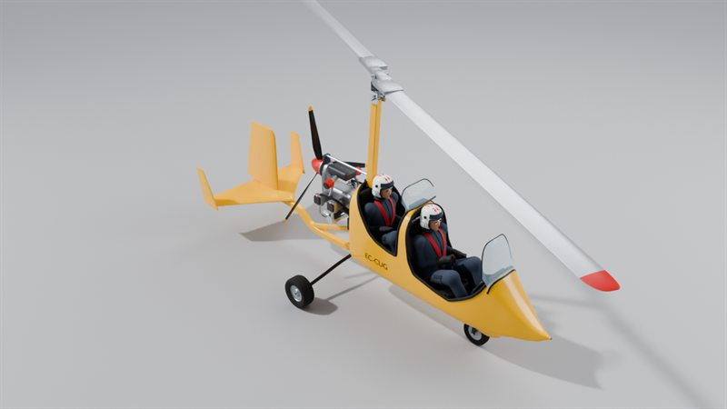
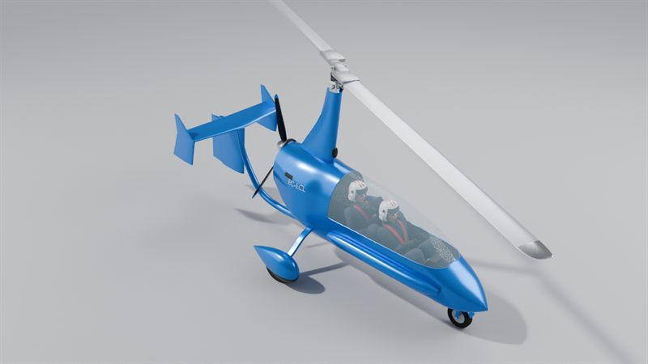

  

<h1 align="center">Autogiro</h1>

  <b>Vuela un autogiro sobre el mundo real</b> 
  Física de autogiro de verdad · relieve y ortofotos del IGN · edificios y árboles en 3D · multijugador

  

  Gratis · Windows 10 y 11 · se actualiza solo ·
  <a href="https://github.com/Marius-Romanus/autogiro/releases">novedades</a>

  

  Hecho con ❤️ por <a href="https://creativecode.es/"><b>Mario</b></a> · más proyectos en
  <a href="https://creativecode.es/"><b>creativecode.es</b></a> ·
  <a href="https://ko-fi.com/mario_creativecode">☕ invítame a un café</a>

---

Un simulador para quien quiera saber cómo se vuela un autogiro de verdad. Despega desde tu aeródromo, sobrevuela tu pueblo o la sierra que conoces y aprende por qué un
autogiro no se pilota como un avión ni como un helicóptero.

- **Física de autogiro, no de avión con hélice arriba.** El rotor gira libre en autorrotación,
  hay que prerrotarlo para despegar, sus vueltas dependen de la carga y avisa si bate las palas o
  si lo descargas. Las prestaciones se han contrastado con datos reales de cada aparato.
- **El mundo real.** En toda España vuelas sobre la ortofoto del PNOA y el relieve de 5 m del IGN,
  con los edificios de OpenStreetMap y los árboles sacados de la propia foto. Con una clave de Google
  puedes usar también el 3D fotorrealista de Google en cualquier parte del planeta.
- **Cielo de verdad.** Atmósfera física, nubes volumétricas con su sombra, la hora y la fecha que
  quieras, viento y turbulencia, y vuelo nocturno con luces de navegación y de aterrizaje.
- **Aeródromos y aeropuertos.** Casarrubios (LEMT), Cuatro Vientos, Barajas, El Prat, Palma,
  Málaga, Sevilla, Valencia, Bilbao, Tenerife Norte y Gran Canaria, con salida en cabecera o en
  final, y lugares para pasear: Madrid, Toledo, El Escorial, Segovia, Gredos, Montserrat, Ordesa…
  o las coordenadas que quieras.
- **Con amigos.** Crea una sala, pasa el código y volad juntos hasta 8 pilotos, con chat.
- **Accidentes realistas.** Si te la pegas, el aparato se rompe por piezas según los golpes.
- **Teclado, ratón, mando o joystick/HOTAS**, con una ayuda al pilotaje opcional para volar con
  teclado sin pelearte con el fugoide.

<table>
  <tr>
    <td width="50%"></td>
    <td width="50%"></td>
  </tr>
  <tr>
    <td align="center">Relojes de rotor, motor, velocidad y variómetro</td>
    <td align="center">Edificios reales en 3D, con sus alturas</td>
  </tr>
</table>

## Los aparatos

<table>
  <tr>
    <td width="50%"></td>
    <td width="50%"></td>
  </tr>
  <tr>
    <td><b>ELA 07 Cougar</b> · tándem abierto de ELA Aviación (Córdoba), Rotax 914 turbo.</td>
    <td><b>ELA 10 Eclipse</b> · cabina cerrada y estilizada, el más rápido, Rotax 914 turbo.</td>
  </tr>
  <tr>
    <td width="50%"></td>
    <td width="50%"></td>
  </tr>
  <tr>
    <td><b>Biplaza tándem</b> · el clásico de escuela tipo MTOsport, Rotax 912.</td>
    <td><b>Cierva C.30A (1934)</b> · homenaje a Juan de la Cierva, con hélice delante, rotor
    tripala, radial de 7 cilindros y rueda de cola. Se vuela como entonces.</td>
  </tr>
</table>

Todos se pueden llevar solos o con pasajero, y cada uno tiene sus pesos, su motor, su rotor y su
cola: no vuelan igual.

## Instalar

1. **[Descarga el instalador](https://github.com/Marius-Romanus/autogiro/releases/latest/download/Autogiro-Setup.exe)**
   (unos 20 MB) y ábrelo.
2. La primera vez Windows puede avisar con *«Windows protegió su PC»* porque el instalador no está
   firmado: pulsa **Más información → Ejecutar de todas formas**.
3. Se instala solo, sin permisos de administrador, y crea el acceso directo en el escritorio.

Cuando salga una versión nueva, el juego te lo dirá al abrirlo y se actualizará con un clic.

**Qué necesitas:** Windows 10 u 11, conexión a Internet (el paisaje se descarga mientras vuelas) y,
mejor, una tarjeta gráfica dedicada. El juego usa siempre la gráfica potente del portátil y elige
la calidad solo; puedes cambiarla en el menú (*Gráficos y mandos → Calidad*). **F11** pone la
pantalla completa.

  

## Tu primer vuelo

1. Quita el **freno de rotor** (`B`) y suelta el **freno de parking** (`L`).
2. **Palanca adelante** (mantén `W`) y **gas al 40 %** (`R`), unas 3000 rpm de motor.
3. Mantén el **prerrotador** (`P`) hasta que el rotor llegue a **200–220 rpm**.
4. A la vez: suelta el prerrotador, **palanca toda atrás** (mantén `S`) y **gas a fondo**.
5. El rotor se embala con la velocidad y se va al aire a unos **70–80 km/h**. Entonces cede
   palanca para acelerar a 90–100 km/h pegado al suelo, y sube.

Para tomar: aproximación a 80–90 km/h y, a unos 6–8 m del suelo, tira de palanca y mantenla
(sale el aviso «RECOGIDA»). Con `H` tienes la ayuda en pantalla en cualquier momento.

## Cómo se vuela (y por qué es distinto)

- **Palanca = velocidad, gas = altura.** La palanca inclina el disco del rotor; el gas te sube o te baja.
- **Sin motor no pasa nada**: el rotor sigue girando y planeas a ~100 km/h bajando unos 6 m/s.
  Con la palanca toda atrás bajas casi en vertical, estable pero demasiado deprisa para tomar.
- **Batimiento de palas:** correr deprisa con pocas vueltas de rotor hace que la pala que avanza
  bata contra los topes. Accidente.
- **Baja carga:** empujar la palanca de golpe descarga el rotor, pierde vueltas y puedes perder el
  control. Mantén siempre carga positiva.
- Vigila el **tacómetro del rotor** (amarillo = prerrotación, verde = vuelo) y, en cabina, el
  **hilo de guiñada** del parabrisas.

## Mandos

| Tecla | Acción |
|---|---|
| `W` `S` / `↑` `↓` | Palanca adelante / atrás. **Se queda donde la dejas**; `Inicio` la centra |
| `A` `D` / `←` `→` | Palanca izquierda / derecha |
| `Q` `E` | Pedales (timón y rueda de morro) |
| `R` `F`, `1`…`0` | Gas |
| `T` `G` | Compensador |
| `P` (mantener) | Prerrotador |
| `B` | Freno de rotor |
| `Espacio` / `L` | Frenos / freno de parking |
| `M` | Arrancar o parar el motor |
| `O` | Luces |
| `C` / `V` | Cambiar de cámara / mirar atrás |
| Ratón (arrastrar, rueda) | Mirar, zoom |
| `K` | Ratón como palanca |
| `Intro` | Chat (en multijugador) |
| `I` / `H` / `Esc` / `Retroceso` | Instrumentos / ayuda / menú / reiniciar |
| `F11` | Pantalla completa |

**Mando tipo Xbox:** stick izquierdo = palanca, stick derecho = pedales, gatillos = gas,
A = prerrotador, B = frenos. **Joystick o HOTAS:** los ejes se configuran en el menú y se ven en vivo.

La **ayuda al pilotaje** (activada de serie) hace con la mano lo que un piloto hace sin pensar:
amortigua las oscilaciones de cabeceo, nivela las alas y modera la recogida al tomar. No cambia la
física. Desactívala en el menú para volar al 100 % a mano.

## Volar con amigos

En el menú, **Multijugador**: escribe tu nombre y pulsa **Crear sala**. Te da un código de
4 letras; tus amigos lo escriben y pulsan **Unirse**. Quien crea la sala elige el lugar, la hora y
el tiempo para todos, y cada uno su aparato.

- **En la misma wifi** entran directamente con la dirección que les indica el juego.
- **Por Internet**, el juego te explica paso a paso cómo abrir un túnel gratuito de Cloudflare
  (*Multijugador → Jugar por Internet*). Tus amigos pueden entrar incluso sin instalar nada, desde
  Chrome o Edge.

## Escenario

| Modo | Qué ves | Necesita |
|---|---|---|
| **Ortofoto + relieve** (de serie) | En España, ortofoto PNOA y relieve de 5 m del IGN, edificios 3D de OpenStreetMap y árboles 3D. Fuera de España, imágenes de satélite de Esri. | Nada |
| **Fotorrealista 3D de Google** | Ciudades, árboles y montañas en 3D fotorrealista en todo el mundo. | Una clave gratuita de Google |

<b>Cómo conseguir la clave de Google</b>

1. Entra en <https://console.cloud.google.com/> y crea un proyecto.
2. Activa la facturación (hay una cuota gratuita mensual generosa).
3. *APIs y servicios → Biblioteca* → habilita **Map Tiles API**.
4. *Credenciales → Crear credenciales → Clave de API*.
5. Pégala en el menú del juego. Se guarda solo en tu ordenador.

## Créditos

Creado por **Mario** · blog y otros proyectos en [creativecode.es](https://creativecode.es/) ·
si te gusta, [invítame a un café en Ko-fi](https://ko-fi.com/mario_creativecode) ☕

- Ortofoto PNOA y MDT05 © Instituto Geográfico Nacional ([scne.es](https://www.scne.es)), CC BY 4.0 ·
  imágenes Esri World Imagery · relieve global Mapzen / AWS Terrain Tiles · Google Photorealistic 3D Tiles © Google.
- Edificios © colaboradores de OpenStreetMap (ODbL), teselas de [OpenFreeMap](https://openfreemap.org) / OpenMapTiles.
- [3d-tiles-renderer](https://github.com/NASA-AMMOS/3DTilesRendererJS) (NASA-AMMOS),
  [three-geospatial](https://github.com/takram-design-engineering/three-geospatial) (takram) para
  atmósfera y nubes, [Three.js](https://threejs.org), [Rapier](https://rapier.rs) y [Tauri](https://tauri.app).
- Cierva C.30A: plano de tres vistas de *Flight* (1934) reproducido en la
  [NACA Aircraft Circular 196](https://ntrs.nasa.gov/citations/19930090361), datos de vuelo de los
  ensayos de la RAE (ARC R&M 1859 y 1727) y decoración de la réplica del Museo del Aire de Madrid.
