

  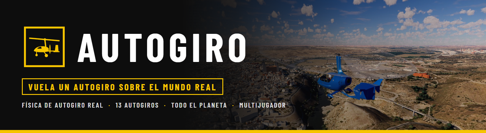

  <b>Español</b> · <a href="#english"><b>English</b></a>

  
  

  Gratis · Windows y Linux · en español e inglés · se actualiza solo ·
  <a href="https://github.com/Marius-Romanus/autogiro/releases">novedades</a>

  Hecho con ❤️ por <a href="https://creativecode.es/"><b>Mario</b></a> · más proyectos en
  <a href="https://creativecode.es/"><b>creativecode.es</b></a> ·
  <a href="https://ko-fi.com/mario_creativecode">☕ invítame a un café</a>

---

Un simulador para quien quiera saber cómo se vuela un autogiro de verdad. Despega desde tu aeródromo, sobrevuela tu pueblo o la sierra que conoces y aprende por qué un
autogiro no se pilota como un avión ni como un helicóptero.

- **Física de autogiro, no de avión con hélice arriba.** El rotor gira libre en autorrotación,
  hay que prerrotarlo para despegar, sus vueltas dependen de la carga y avisa si bate las palas o
  si lo descargas. Las prestaciones se han contrastado con datos reales de cada aparato.
- **16 autogiros distintos.** De escuela, de cabina cerrada, monoplazas de bastidor abierto, el
  Cierva C.30A de 1934, el Wallis WA-116, un fumigador que fumiga de verdad (tecla U), el compuesto
  Carter PAV y un futurista inventado, cada uno con su motor, su rotor y su física.
- **El mundo real.** En toda España vuelas sobre la ortofoto del PNOA y el relieve de 5 m del IGN,
  con los edificios de OpenStreetMap y del Catastro con sus tejados, y los árboles sacados de la propia
  foto. En todo el planeta hay mar, lagos y ríos con oleaje y reflejos, puentes en 3D por los que se
  puede pasar por debajo y tendidos eléctricos contra los que te puedes estrellar. Con una clave de
  Google puedes usar también el 3D fotorrealista de Google en cualquier parte del planeta.
- **Ciudades con vida.** Coches, furgonetas, camiones y autobuses circulan por las calles de todo el
  mundo respetando carriles, cedas el paso, rotondas y semáforos; hay trenes y tranvías, y ferris,
  barcos de recreo, pesqueros y mercantes en puertos, lagos y ríos. Al anochecer se encienden las
  farolas y las ventanas de los edificios.
- **Cielo de verdad.** Atmósfera física, nubes volumétricas con su sombra, la hora y la fecha que
  quieras, viento y turbulencia, y vuelo nocturno con luces de navegación y de aterrizaje.
- **Sal desde cualquier punto del planeta.** En el menú, «Elegir en el mapa del mundo» abre un globo
  terráqueo que se gira y se acerca como en los simuladores de vuelo: más de 48 000 aeródromos del
  mundo con todas sus pistas para despegar de cualquier cabecera o llegar en final, un buscador
  (OACI, IATA, ciudades, montañas o coordenadas) y, si no, pinchas donde quieras y eliges rumbo, en
  el suelo o en vuelo.
  Casarrubios (LEMT), Cuatro Vientos, Barajas, El Prat, Palma, Málaga, Sevilla, Valencia, Bilbao,
  Tenerife Norte y Gran Canaria tienen además sus salidas preparadas (en cabecera, en final o en
  el circuito).
- **Sitios emblemáticos de España y del mundo.** Más de 170 salidas en vuelo: eliges el país (con
  un buscador) y luego el sitio:
  en España, al menos uno por provincia (la Alhambra, la Sagrada Familia, Santiago, Las Médulas,
  Gaztelugatxe, el Teide, Es Vedrà, Ceuta y Melilla…), y por todo el mundo el Cervino, el
  Mont-Saint-Michel, la torre Eiffel, el Vaticano, la Costa Amalfitana, los fiordos noruegos, las
  pirámides de Guiza, el Taj Mahal, el monte Fuji, la Ciudad Prohibida, la bahía de Ha Long, Nueva
  York, Las Vegas, el Gran Cañón, Machu Picchu, Iguazú, la Patagonia, Bora Bora…
- **Con amigos.** Crea una sala, pasa el código y volad juntos hasta 8 pilotos, con chat.
- **Accidentes realistas.** Si te la pegas, el aparato se rompe por piezas según los golpes.
- **Teclado, ratón, mando o joystick/HOTAS**, con una ayuda al pilotaje opcional para volar con
  teclado sin pelearte con el fugoide.
- **En español e inglés.** El juego se pone en el idioma de tu ordenador y se cambia en el menú
  (botones `ES` / `EN`, arriba).

<table>
  <tr>
    <td width="50%"></td>
    <td width="50%"></td>
  </tr>
  <tr>
    <td align="center">Madrid con sus edificios y tejados en 3D</td>
    <td align="center">El puente de Rande y la ría de Vigo, con el sol en el agua</td>
  </tr>
  <tr>
    <td width="50%">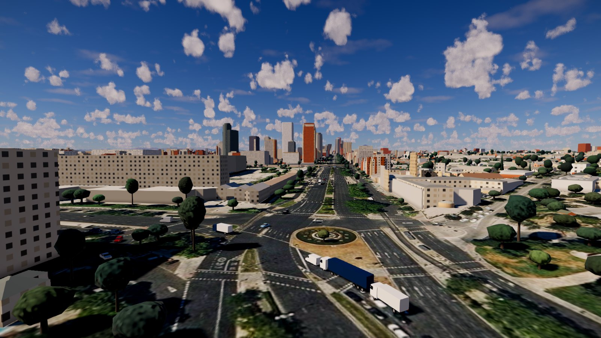</td>
    <td width="50%"></td>
  </tr>
  <tr>
    <td align="center">Tráfico en la Castellana: coches, furgonetas y tráileres</td>
    <td align="center">Madrid al anochecer: farolas, ventanas y faros encendidos</td>
  </tr>
  <tr>
    <td width="50%"></td>
    <td width="50%"></td>
  </tr>
  <tr>
    <td align="center">Relojes de rotor, motor, velocidad y variómetro</td>
    <td align="center">El menú: aparato, salida, hora y meteo, escenario y multijugador</td>
  </tr>
</table>

## Los aparatos

<table>
  <tr>
    <td width="50%"></td>
    <td width="50%"></td>
  </tr>
  <tr>
    <td><b>ELA 07 Cougar</b> · tándem abierto de ELA Aviación (Córdoba), Rotax 914 turbo.</td>
    <td><b>ELA 10 Eclipse</b> · cabina cerrada y estilizada, el más rápido, Rotax 914 turbo.</td>
  </tr>
  <tr>
    <td width="50%"></td>
    <td width="50%">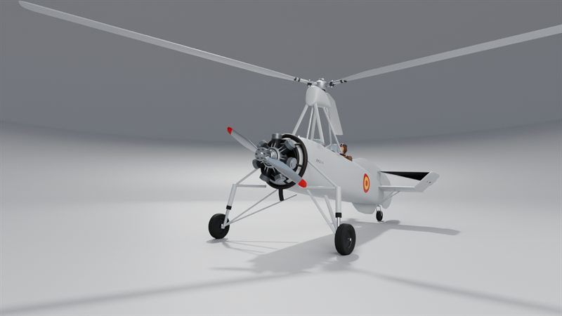</td>
  </tr>
  <tr>
    <td><b>Biplaza tándem</b> · el clásico de escuela tipo MTOsport, Rotax 912.</td>
    <td><b>Cierva C.30A (1934)</b> · homenaje a Juan de la Cierva, con hélice delante, rotor
    tripala, radial de 7 cilindros y rueda de cola. Se vuela como entonces.</td>
  </tr>
  <tr>
    <td width="50%">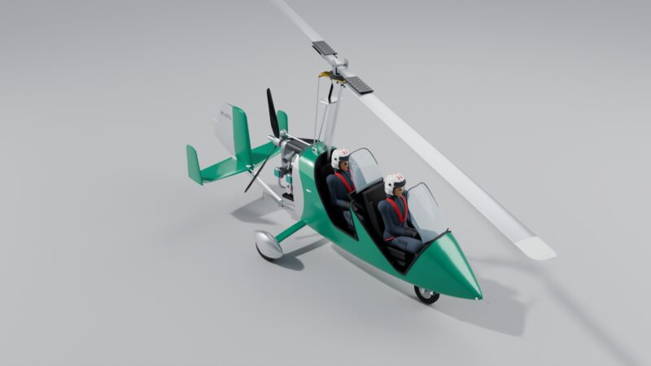</td>
    <td width="50%">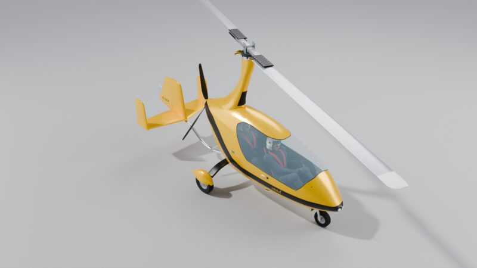</td>
  </tr>
  <tr>
    <td><b>AutoGyro MT-03</b> · el tándem abierto alemán que popularizó el autogiro moderno, Rotax 912.</td>
    <td><b>AutoGyro Calidus</b> · cabina cerrada en tándem, fina y rápida, Rotax 914 turbo.</td>
  </tr>
  <tr>
    <td width="50%">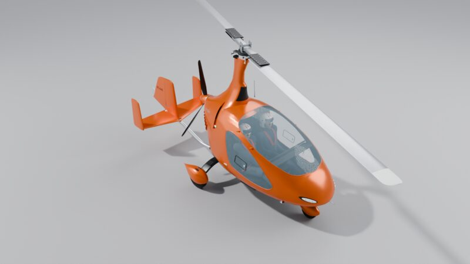</td>
    <td width="50%">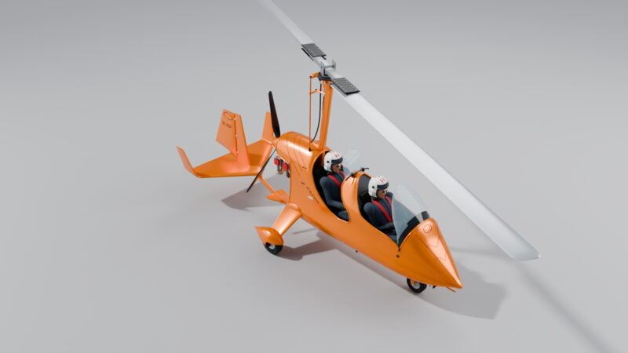</td>
  </tr>
  <tr>
    <td><b>AutoGyro Cavalon</b> · cabina cerrada con los dos asientos lado a lado; el piloto va a la derecha.</td>
    <td><b>ELA 07 Scorpion</b> · el ELA 07 deportivo: motor carenado, dos parabrisas y cola alta, Rotax 914.</td>
  </tr>
  <tr>
    <td width="50%">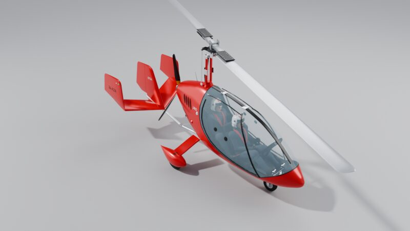</td>
    <td width="50%"></td>
  </tr>
  <tr>
    <td><b>DTA J-RO</b> · tándem cerrado francés de carbono, con puertas de ala de gaviota y tres derivas.</td>
    <td><b>Niki Lightning</b> · búlgaro, con la hélice en medio del aparato, girando alrededor del tubo de cola.</td>
  </tr>
  <tr>
    <td width="50%">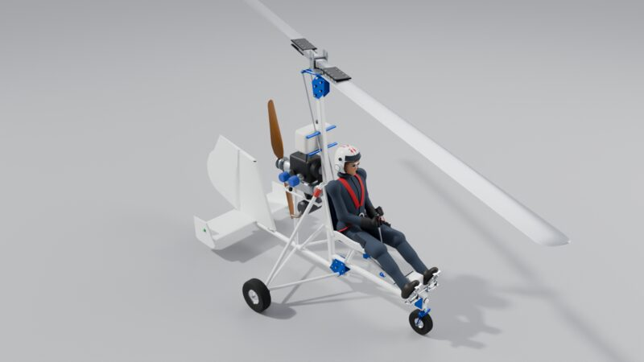</td>
    <td width="50%">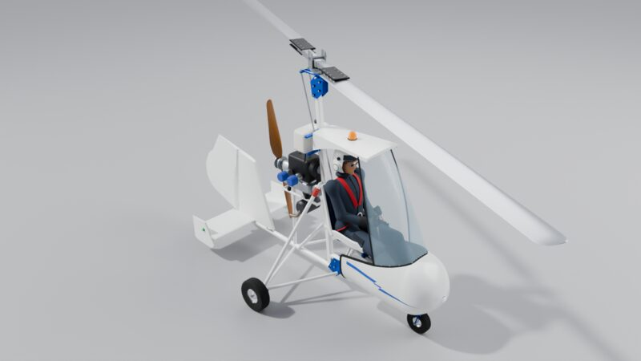</td>
  </tr>
  <tr>
    <td><b>Sport Copter Lightning</b> · ultraligero monoplaza de bastidor abierto, con un Rotax 503 de dos tiempos.</td>
    <td><b>Sport Copter Lightning carenado</b> · el mismo monoplaza con morro, parabrisas y techo.</td>
  </tr>
  <tr>
    <td width="50%"></td>
    <td width="50%">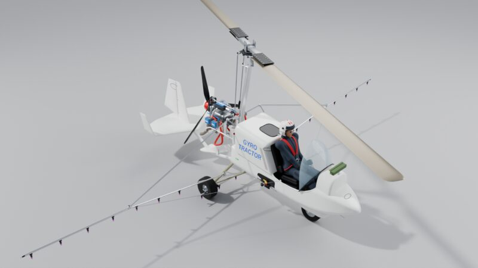</td>
  </tr>
  <tr>
    <td><b>Carter PAV</b> · compuesto de rotor lento con alas de 13,7 m: despega de un salto y, a 250 km/h, el rotor gira a poco más de 100 rpm.</td>
    <td><b>ELA Gyro Tractor</b> · el fumigador de ELA: tolva de 200 l y barras de 8,25 m. Con la tecla <kbd>U</kbd> fumiga pasadas de 15 m y se va aligerando.</td>
  </tr>
  <tr>
    <td width="50%">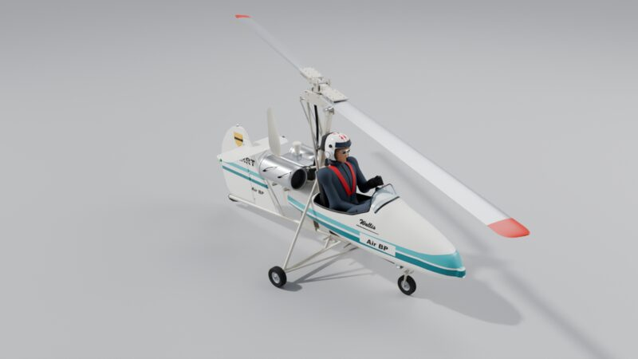</td>
    <td width="50%"></td>
  </tr>
  <tr>
    <td><b>Wallis WA-116 Agile (1961)</b> · el monoplaza diminuto de Ken Wallis, hermano de «Little Nellie», con un motor de dos tiempos de 72 CV.</td>
    <td><b>Vencejo X1</b> · un futurista inventado para el juego: cúpula de una pieza, rotor tripala y hélice carenada.</td>
  </tr>
</table>

Todos menos los monoplazas (Sport Copter, Gyro Tractor y WA-116) se pueden llevar solos o con pasajero, y cada uno tiene sus pesos, su motor, su rotor y su
cola: no vuelan igual.

## Instalar

### Windows

1. **[Descarga el instalador](https://github.com/Marius-Romanus/autogiro/releases/latest/download/Autogiro-Setup.exe)**
   (unos 20 MB) y ábrelo.
2. La primera vez Windows puede avisar con *«Windows protegió su PC»* porque el instalador no está
   firmado: pulsa **Más información → Ejecutar de todas formas**.
3. Se instala solo, sin permisos de administrador, y crea el acceso directo en el escritorio.

### Linux

1. **[Descarga el AppImage](https://github.com/Marius-Romanus/autogiro/releases/latest/download/Autogiro-Linux.AppImage)**
   (unos 125 MB), que vale para cualquier distribución.
2. Dale permiso de ejecución: *clic derecho → Propiedades → Permitir ejecutar como programa*, o en
   la terminal `chmod +x Autogiro-Linux.AppImage`.
3. Ábrelo con doble clic. No hace falta instalar nada más.

Si prefieres un paquete de tu distribución, también está en
**[.deb](https://github.com/Marius-Romanus/autogiro/releases/latest/download/Autogiro-Linux.deb)**
(Ubuntu, Debian, Mint…) y
**[.rpm](https://github.com/Marius-Romanus/autogiro/releases/latest/download/Autogiro-Linux.rpm)**
(Fedora, openSUSE…); esos piden tu contraseña al instalarse y al actualizarse.

Cuando salga una versión nueva, el juego te lo dirá al abrirlo y se actualizará con un clic.

**Qué necesitas:** Windows 10 u 11 o un Linux de 64 bits reciente (Ubuntu 22.04, Debian 12,
Fedora 36 o más nuevos), conexión a Internet (el paisaje se descarga mientras vuelas) y, mejor, una
tarjeta gráfica dedicada. El juego elige la calidad solo; puedes cambiarla en el menú (*Ajustes →
Gráficos → Calidad*). En Windows usa siempre la gráfica potente del portátil. **F11** pone la
pantalla completa.

## Tu primer vuelo

1. Quita el **freno de rotor** (`B`) y suelta el **freno de parking** (`O`).
2. **Palanca adelante** (mantén `W`) y **gas al 40 %** (`R`), unas 3000 rpm de motor.
3. Mantén el **prerrotador** (`P`) hasta que el rotor llegue a **200–220 rpm**.
4. A la vez: suelta el prerrotador, **palanca toda atrás** (mantén `S`) y **gas a fondo**.
5. El rotor se embala con la velocidad y se va al aire a unos **70–80 km/h**. Entonces cede
   palanca para acelerar a 90–100 km/h pegado al suelo, y sube.

Para tomar: aproximación a 80–90 km/h y, a unos 6–8 m del suelo, tira de palanca y mantenla
(sale el aviso «RECOGIDA»). Con `H` tienes la ayuda en pantalla en cualquier momento.

## Cómo se vuela (y por qué es distinto)

- **Palanca = velocidad, gas = altura.** La palanca inclina el disco del rotor; el gas te sube o te baja.
- **Sin motor no pasa nada**: el rotor sigue girando y planeas a ~100 km/h bajando unos 6 m/s.
  Con la palanca toda atrás bajas casi en vertical, estable pero demasiado deprisa para tomar.
- **Batimiento de palas:** correr deprisa con pocas vueltas de rotor hace que la pala que avanza
  bata contra los topes. Accidente.
- **Baja carga:** empujar la palanca de golpe descarga el rotor, pierde vueltas y puedes perder el
  control. Mantén siempre carga positiva.
- Vigila el **tacómetro del rotor** (amarillo = prerrotación, verde = vuelo) y, en cabina, el
  **hilo de guiñada** del parabrisas.

## Mandos

| Tecla | Acción |
|---|---|
| `W` `S` / `↑` `↓` | Palanca adelante / atrás. **Se queda donde la dejas**; `Inicio` la centra |
| `A` `D` / `←` `→` | Palanca izquierda / derecha |
| `Q` `E` | Pedales (timón y rueda de morro) |
| `R` `F`, `1`…`0` | Gas |
| `T` `G` | Compensador |
| `P` (mantener) | Prerrotador |
| `B` | Freno de rotor |
| `Espacio` / `O` | Frenos / freno de parking |
| `M` | Arrancar o parar el motor |
| `L` | Luces |
| `U` | Fumigar (Gyro Tractor) |
| `J` | Guía de pilotaje lateral (despegue, vuelo y aterrizaje); también con el botón «Guía» |
| `C` / `V` | Cambiar de cámara / mirar atrás |
| Ratón (arrastrar, rueda) | Mirar, zoom |
| `K` | Ratón como palanca |
| `Intro` | Chat (en multijugador) |
| `I` / `H` / `Esc` / `Retroceso` | Instrumentos / ayuda / menú / reiniciar |
| `F11` | Pantalla completa |

**Mando tipo Xbox:** stick izquierdo = palanca, stick derecho = pedales, gatillos = gas,
A = prerrotador, B = frenos. **Joystick o HOTAS:** los ejes se configuran en el menú y se ven en vivo.

La **ayuda al pilotaje** (activada de serie) hace con la mano lo que un piloto hace sin pensar:
amortigua las oscilaciones de cabeceo, nivela las alas y modera la recogida al tomar. No cambia la
física. Desactívala en el menú para volar al 100 % a mano.

## Volar con amigos

En el menú, **Multijugador**: escribe tu nombre y pulsa **Crear sala**. Te da un código de
4 letras; tus amigos lo escriben y pulsan **Unirse**. Quien crea la sala elige el lugar, la hora y
el tiempo para todos, y cada uno su aparato.

- **En la misma wifi** entran directamente con la dirección que les indica el juego.
- **Por Internet**, el juego te explica paso a paso cómo abrir un túnel gratuito de Cloudflare
  (*Multijugador → Jugar por Internet*). Tus amigos pueden entrar incluso sin instalar nada, desde
  Chrome o Edge.

## Escenario

| Modo | Qué ves | Necesita |
|---|---|---|
| **Ortofoto + relieve** (de serie) | En España, ortofoto PNOA y relieve de 5 m del IGN, edificios 3D de OpenStreetMap y del Catastro con tejados inclinados, y árboles 3D. Fuera de España, imágenes de satélite de Esri. En todo el mundo, mar, lagos y ríos con oleaje y reflejos, puentes y tendidos eléctricos en 3D, y tráfico por las calles. | Nada |
| **Fotorrealista 3D de Google** | Ciudades, árboles y montañas en 3D fotorrealista en todo el mundo. | Una clave gratuita de Google |

### Edificios y tejados

- **Tejados inclinados**: las casas y los bloques bajos llevan tejado a dos o cuatro aguas, los hangares
  de los aeródromos en bóveda y los cascos antiguos con faldones desde cada fachada. Los bloques altos y
  las naves industriales quedan con azotea plana. Ni OpenStreetMap ni el Catastro dicen cómo es cada
  tejado, así que la forma se deduce de la planta: se parece a la realidad, pero no es una copia exacta.
- **Edificios del Catastro** (España): muchas casas no están en OpenStreetMap, sobre todo en
  urbanizaciones y pueblos. El juego las completa con los edificios del Catastro, con su número real
  de plantas. Se descargan solos por municipios, los de alrededor y los que tienes por delante en el
  rumbo que llevas, de modo que al llegar ya están. Cada municipio se descarga una sola vez (entre 1 y 6 MB;
  Madrid capital, unos 120 MB, solo si vuelas por encima) y se queda guardado en tu ordenador: un pueblo
  ocupa unos cientos de kB y una ciudad como Móstoles, unos 3 MB.
  - *Menú → Escenario → Completar con el Catastro* lo activa o lo quita.
  - *Menú → Escenario → Datos del Catastro descargados* muestra cada municipio guardado y lo que ocupa,
    con un botón para borrarlo (o borrarlo todo).
  - País Vasco y Navarra tienen catastro propio y no están incluidos: allí se ven solo los de OpenStreetMap.

### Agua

El mar, los lagos, los embalses y los ríos de todo el mundo conservan el color que tienen en la foto (el
azul oscuro del mar abierto, el turquesa de un arrecife, el verde de un embalse) y encima llevan lo que
hace que el agua parezca agua: reflejan el cielo, más cuanto más a ras miras; el sol deja su camino de
destellos; y el oleaje sale del **viento que pongas en el menú**. En calma un lago es un espejo; con 10 nudos
el agua se riza a rachas; desde unos 12 nudos el mar saca borreguillos. Un piloto lee el viento en el agua,
y aquí también se puede.

### Tendidos eléctricos

Las líneas eléctricas de todo el mundo están en 3D: torres de celosía de alta tensión, apoyos de media
y postes de baja, cada uno con su forma según la tensión, y los cables colgando entre ellos. Se ven
como en vuelo: las torres desde lejos y los cables nítidos solo de cerca, cuando ya casi no da tiempo.
**Se choca con ellos**: un cable que entra en el disco del rotor parte las palas. Sirven también para
navegar, como en la realidad. En España salen de un fichero que va con el juego; fuera, de OpenInfraMap.
Las de teléfono casi no están en los mapas, así que apenas aparecen.
*Menú → Escenario → Tendidos eléctricos* los quita o los pone, también a mitad de vuelo.

### Puentes

Los puentes de OpenStreetMap de todo el mundo están en 3D, con su tablero a la altura de los estribos,
sus pilas y, según el tipo, sus arcos, celosías, tirantes o cables colgantes (el tipo sale de
Wikidata). Se puede pasar por debajo, posarse y rodar por el tablero o, si no calculas bien, chocar con
ellos. Donde el relieve trae el puente como si fuera un dique, el terreno se rebaja por debajo para que
pase el río. Van con los *Edificios 3D* del menú.

### Tráfico y ciudades de noche

Por las carreteras y calles de OpenStreetMap de cualquier parte del mundo circulan coches, furgonetas,
camiones, tráileres y autobuses, por el lado que toca en cada país: van por su carril, ceden el paso,
entran en las rotondas, paran en los semáforos y no se atraviesan unos a otros. Hay trenes y tranvías,
con sus pasos a nivel, y ferris, barcos de recreo, pesqueros y mercantes en puertos, lagos y ríos. Es
tráfico simulado, no el real del momento, y cambia con la hora: en hora punta hay más. Se puede chocar
con ellos, así que ojo al tomar en un camino.

Al anochecer los vehículos encienden los faros, las farolas alumbran las calles urbanas y sus fachadas
(unas de sodio, naranjas, y otras LED, blancas) y se encienden las ventanas de los edificios: muchas hacia las
nueve de la noche y pocas de madrugada. *Menú → Escenario → Tráfico* quita los vehículos; las farolas
y las ventanas siguen.

<b>Cómo conseguir la clave de Google</b>

1. Entra en <https://console.cloud.google.com/> y crea un proyecto.
2. Activa la facturación (hay una cuota gratuita mensual generosa).
3. *APIs y servicios → Biblioteca* → habilita **Map Tiles API**.
4. *Credenciales → Crear credenciales → Clave de API*.
5. Pégala en el menú del juego. Se guarda solo en tu ordenador.

## Créditos

Creado por **Mario** · blog y otros proyectos en [creativecode.es](https://creativecode.es/) ·
si te gusta, [invítame a un café en Ko-fi](https://ko-fi.com/mario_creativecode) ☕

- Ortofoto PNOA y MDT05 © Instituto Geográfico Nacional ([scne.es](https://www.scne.es)), CC BY 4.0 ·
  imágenes Esri World Imagery · relieve global Mapzen / AWS Terrain Tiles · Google Photorealistic 3D Tiles © Google.
- Tendidos eléctricos © colaboradores de OpenStreetMap (ODbL): en España, del volcado de
  [Geofabrik](https://download.geofabrik.de); fuera, teselas de [Open Infrastructure Map](https://openinframap.org).
- Edificios, formas de tejado, agua (mar, lagos y ríos), puentes y las calles, vías y puertos del tráfico
  © colaboradores de OpenStreetMap (ODbL), teselas de [OpenFreeMap](https://openfreemap.org) / OpenMapTiles,
  y © [Dirección General del Catastro](https://www.catastro.hacienda.gob.es) (datos INSPIRE de edificios).
- Tipo de estructura de los puentes (colgante, atirantado, arco, celosía): [Wikidata](https://www.wikidata.org) (CC0).
- Mapa del mundo: aeródromos de [OurAirports](https://ourairports.com/data/) (dominio público), pistas y
  búsqueda de lugares © colaboradores de OpenStreetMap (OpenFreeMap y [Nominatim](https://nominatim.openstreetmap.org)).
- [3d-tiles-renderer](https://github.com/NASA-AMMOS/3DTilesRendererJS) (NASA-AMMOS),
  [three-geospatial](https://github.com/takram-design-engineering/three-geospatial) (takram) para
  atmósfera y nubes, [Three.js](https://threejs.org), [Rapier](https://rapier.rs) y [Tauri](https://tauri.app),
  [straight-skeleton](https://github.com/StrandedKitty/straight-skeleton) (vHawk, MIT) para los tejados y
  [fflate](https://github.com/101arrowz/fflate) para descomprimir los datos del Catastro.
- Cierva C.30A: plano de tres vistas de *Flight* (1934) reproducido en la
  [NACA Aircraft Circular 196](https://ntrs.nasa.gov/citations/19930090361), datos de vuelo de los
  ensayos de la RAE (ARC R&M 1859 y 1727) y decoración de la réplica del Museo del Aire de Madrid.
- MT-03, Calidus, Cavalon, ELA 07 Cougar y Scorpion, ELA 10, ELA Gyro Tractor, J-RO, Niki Lightning, Sport Copter
  Lightning, Wallis WA-116 y Carter PAV:
  calcados sobre fotos de [Wikimedia Commons](https://commons.wikimedia.org) y de sus fabricantes, los
  manuales de vuelo de AutoGyro y DTA, las hojas de datos de la CAA británica y, para el Carter PAV, el
  artículo de Carter y Lewis en el European Rotorcraft Forum de 2015.

## Licencia

Autogiro es gratis para jugar, estudiar y modificar con cualquier fin **no comercial**: uso personal,
aficionados, clubes, escuelas y asociaciones sin ánimo de lucro. **No se permite venderlo ni usarlo para
ganar dinero** (tampoco versiones modificadas) sin permiso del autor. Si lo compartes o publicas una versión
modificada, tiene que ir con la licencia y el aviso de autoría: *Copyright (c) 2026 Mario (creativecode.es)*.
Texto completo en [LICENSE](LICENSE) ([PolyForm Noncommercial 1.0.0](https://polyformproject.org/licenses/noncommercial/1.0.0)).
Para un uso comercial, escríbeme a través de [creativecode.es](https://creativecode.es/).

---

  

  <a href="#espanol"><b>Español</b></a> · <b>English</b>

  
  

  Free · Windows and Linux · in English and Spanish · updates itself ·
  <a href="https://github.com/Marius-Romanus/autogiro/releases">release notes</a> (in Spanish)

  Made with ❤️ by <a href="https://creativecode.es/"><b>Mario</b></a> · more projects at
  <a href="https://creativecode.es/"><b>creativecode.es</b></a> ·
  <a href="https://ko-fi.com/mario_creativecode">☕ buy me a coffee</a>

A simulator for anyone who wants to know how a real autogyro (gyrocopter, gyroplane) flies. Take off
from your airfield, fly over your town or the mountains you know, and learn why a gyro is flown neither
like an aeroplane nor like a helicopter.

- **Gyro physics, not an aeroplane with a propeller on top.** The rotor spins freely in
  autorotation, you have to pre-rotate it to take off, its RPM depends on the load, and it warns you
  about blade flapping and low-g. Performance has been checked against real data for each aircraft.
- **16 different gyrocopters.** Trainers, enclosed cabins, open-frame single-seaters, the 1934
  Cierva C.30A, the Wallis WA-116, a crop sprayer that really sprays (U key), the Carter PAV
  compound and an invented futuristic one, each with its own engine, rotor and physics.
- **The real world.** All over Spain you fly over the IGN's PNOA orthophotos and 5 m terrain model,
  with OpenStreetMap and Land Registry buildings with their roofs, and trees detected in the photo
  itself. Outside Spain you get Esri satellite imagery. All over the planet there are seas, lakes and
  rivers with waves and reflections, 3D bridges you can fly under and power lines you can crash into.
  With a Google key you can also use Google's photorealistic 3D anywhere on Earth.
- **Living cities.** Cars, vans, lorries and buses drive through the streets all over the world,
  keeping to their lanes, giving way and handling roundabouts and traffic lights; there are trains
  and trams, and ferries, pleasure boats, fishing boats and cargo ships in harbours, lakes and rivers.
  At dusk the street lights and the building windows light up.
- **A real sky.** Physical atmosphere, volumetric clouds with their shadows, any time and date,
  wind and turbulence, and night flying with navigation and landing lights.
- **Start anywhere on the planet.** In the menu, “Pick on the world map” opens a globe you spin and
  zoom like in flight simulators: over 48,000 airfields worldwide with all their runways to take off
  from any threshold or start on final, a search box (ICAO, IATA, cities, mountains or coordinates)
  or just click anywhere and choose your heading, on the ground or in flight.
  Casarrubios (LEMT), Cuatro Vientos, Madrid-Barajas, Barcelona, Palma, Málaga, Seville, Valencia,
  Bilbao, Tenerife North and Gran Canaria also have ready-made starts (on the runway, on final or in
  the circuit).
- **Landmarks in Spain and around the world.** Over 170 in-flight starts: pick the country (with a
  search box) and then the place. At least
  one in every Spanish province (the Alhambra, the Sagrada Família, Santiago, Las Médulas,
  Gaztelugatxe, Mount Teide, Es Vedrà, Ceuta and Melilla…), and worldwide the Matterhorn,
  Mont-Saint-Michel, the Eiffel Tower, the Vatican, the Amalfi Coast, the Norwegian fjords, the
  Pyramids of Giza, the Taj Mahal, Mount Fuji, the Forbidden City, Ha Long Bay, New York, Las Vegas,
  the Grand Canyon, Machu Picchu, Iguazú, Patagonia, Bora Bora…
- **With friends.** Create a room, share the code and fly together, up to 8 pilots, with chat.
- **Realistic crashes.** If you crash, the aircraft breaks apart piece by piece depending on the impacts.
- **Keyboard, mouse, gamepad or joystick/HOTAS**, with an optional flying assist so you can fly with
  the keyboard without fighting the phugoid.
- **In English and Spanish.** The game follows your computer's language, and you can switch it in the
  menu (`ES` / `EN` buttons at the top).

<table>
  <tr>
    <td width="50%"></td>
    <td width="50%"></td>
  </tr>
  <tr>
    <td align="center">Madrid with its 3D buildings and roofs</td>
    <td align="center">The Rande bridge over the Vigo estuary, with the sun on the water</td>
  </tr>
  <tr>
    <td width="50%"></td>
    <td width="50%"></td>
  </tr>
  <tr>
    <td align="center">Traffic on the Castellana: cars, vans and articulated lorries</td>
    <td align="center">Madrid at dusk: street lights, windows and headlights on</td>
  </tr>
  <tr>
    <td width="50%"></td>
    <td width="50%"></td>
  </tr>
  <tr>
    <td align="center">Rotor, engine, airspeed and vertical speed gauges</td>
    <td align="center">The menu: aircraft, departure, time and weather, scenery and multiplayer</td>
  </tr>
</table>

## The aircraft

<table>
  <tr>
    <td width="50%"></td>
    <td width="50%"></td>
  </tr>
  <tr>
    <td><b>ELA 07 Cougar</b> · open tandem by ELA Aviación (Córdoba, Spain), Rotax 914 turbo.</td>
    <td><b>ELA 10 Eclipse</b> · sleek enclosed cabin, the fastest one, Rotax 914 turbo.</td>
  </tr>
  <tr>
    <td width="50%"></td>
    <td width="50%"></td>
  </tr>
  <tr>
    <td><b>Two-seat tandem</b> · the classic MTOsport-style trainer, Rotax 912.</td>
    <td><b>Cierva C.30A (1934)</b> · a tribute to Juan de la Cierva, the inventor of the autogyro:
    tractor propeller, three-blade rotor, 7-cylinder radial engine and tailwheel. You fly it the way
    it was flown back then.</td>
  </tr>
  <tr>
    <td width="50%"></td>
    <td width="50%"></td>
  </tr>
  <tr>
    <td><b>AutoGyro MT-03</b> · the German open tandem that made the modern gyroplane popular, Rotax 912.</td>
    <td><b>AutoGyro Calidus</b> · sleek, fast enclosed tandem, Rotax 914 turbo.</td>
  </tr>
  <tr>
    <td width="50%"></td>
    <td width="50%"></td>
  </tr>
  <tr>
    <td><b>AutoGyro Cavalon</b> · enclosed cabin with side-by-side seats; the pilot sits on the right.</td>
    <td><b>ELA 07 Scorpion</b> · the sporty ELA 07: cowled engine, two windscreens and a high tail, Rotax 914.</td>
  </tr>
  <tr>
    <td width="50%"></td>
    <td width="50%"></td>
  </tr>
  <tr>
    <td><b>DTA J-RO</b> · French enclosed carbon tandem with gull-wing doors and three fins.</td>
    <td><b>Niki Lightning</b> · Bulgarian, with the propeller in the middle of the airframe, turning round the tail boom.</td>
  </tr>
  <tr>
    <td width="50%"></td>
    <td width="50%"></td>
  </tr>
  <tr>
    <td><b>Sport Copter Lightning</b> · open-frame single-seat ultralight with a two-stroke Rotax 503.</td>
    <td><b>Sport Copter Lightning (faired)</b> · the same single-seater with a nose pod, windscreen and roof.</td>
  </tr>
  <tr>
    <td width="50%"></td>
    <td width="50%"></td>
  </tr>
  <tr>
    <td><b>Carter PAV</b> · slowed-rotor compound with 13.7 m wings: it jumps off the ground and, at 250 km/h, its rotor turns at just over 100 rpm.</td>
    <td><b>ELA Gyro Tractor</b> · ELA's crop sprayer: 200 l hopper and 8.25 m booms. Press <kbd>U</kbd> to spray 15 m swaths; it gets lighter as it goes.</td>
  </tr>
  <tr>
    <td width="50%"></td>
    <td width="50%"></td>
  </tr>
  <tr>
    <td><b>Wallis WA-116 Agile (1961)</b> · Ken Wallis's tiny single-seater, sister of "Little Nellie", with a 72 hp two-stroke engine.</td>
    <td><b>Vencejo X1</b> · a futuristic one invented for the game: one-piece canopy, three-blade rotor and ducted fan.</td>
  </tr>
</table>

All but the single-seaters (Sport Copter, Gyro Tractor and WA-116) can be flown solo or with a passenger, and each one has its own weights, engine, rotor
and tail: they don't fly the same.

## Install

### Windows

1. **[Download the installer](https://github.com/Marius-Romanus/autogiro/releases/latest/download/Autogiro-Setup.exe)**
   (about 20 MB) and run it. It shows up in English or Spanish depending on your Windows.
2. The first time, Windows may show *“Windows protected your PC”* because the installer isn't signed:
   click **More info → Run anyway**.
3. It installs by itself, without administrator rights, and adds a shortcut to your desktop.

### Linux

1. **[Download the AppImage](https://github.com/Marius-Romanus/autogiro/releases/latest/download/Autogiro-Linux.AppImage)**
   (about 125 MB), which works on any distribution.
2. Make it executable: *right click → Properties → Allow executing as program*, or in a terminal
   `chmod +x Autogiro-Linux.AppImage`.
3. Double-click it. Nothing else to install.

If you'd rather use a package for your distribution, there are also
**[.deb](https://github.com/Marius-Romanus/autogiro/releases/latest/download/Autogiro-Linux.deb)**
(Ubuntu, Debian, Mint…) and
**[.rpm](https://github.com/Marius-Romanus/autogiro/releases/latest/download/Autogiro-Linux.rpm)**
(Fedora, openSUSE…) packages; those ask for your password when installing and updating.

When a new version comes out, the game tells you when you open it and updates with one click.

**You need:** Windows 10 or 11 or a recent 64-bit Linux (Ubuntu 22.04, Debian 12, Fedora 36 or
newer), an Internet connection (the scenery is downloaded as you fly) and, ideally, a dedicated
graphics card. The game picks the quality by itself; you can change it in the menu (*Settings →
Graphics → Quality*). On Windows it always uses the laptop's powerful GPU. **F11** toggles full
screen.

## Your first flight

1. Release the **rotor brake** (`B`) and the **parking brake** (`O`).
2. **Stick forward** (hold `W`) and **40 % throttle** (`R`), about 3000 engine rpm.
3. Hold the **pre-rotator** (`P`) until the rotor reaches **200–220 rpm**.
4. All at once: let go of the pre-rotator, **full back stick** (hold `S`) and **full throttle**.
5. The rotor speeds up as you gain speed and you lift off at about **70–80 km/h**. Then ease the
   stick forward to accelerate to 90–100 km/h close to the ground, and climb.

To land: approach at 80–90 km/h and, about 6–8 m above the ground, pull the stick back and hold it
(the “FLARE” warning appears). Press `H` for the on-screen help at any time.

## How to fly a gyro (and why it's different)

- **Stick = speed, throttle = height.** The stick tilts the rotor disc; the throttle makes you
  climb or descend.
- **No engine, no panic:** the rotor keeps turning and you glide at ~100 km/h, sinking about 6 m/s.
  With full back stick you come down almost vertically: stable, but too fast to land.
- **Blade flapping:** taxiing fast with low rotor RPM makes the advancing blade hit its stops. Crash.
- **Low-g:** pushing the stick forward abruptly unloads the rotor, it loses RPM and you can lose
  control. Always keep positive load.
- Keep an eye on the **rotor tachometer** (yellow = pre-rotation, green = flight) and, in the
  cockpit, on the **yaw string** on the windscreen.

## Controls

| Key | Action |
|---|---|
| `W` `S` / `↑` `↓` | Stick forward / back. **It stays where you leave it**; `Home` centres it |
| `A` `D` / `←` `→` | Stick left / right |
| `Q` `E` | Pedals (rudder and nose wheel) |
| `R` `F`, `1`…`0` | Throttle |
| `T` `G` | Trim |
| `P` (hold) | Pre-rotator |
| `B` | Rotor brake |
| `Space` / `O` | Brakes / parking brake |
| `M` | Start or stop the engine |
| `L` | Lights |
| `U` | Crop spraying (Gyro Tractor) |
| `J` | Side flying guide (takeoff, flight and landing); also the «Guide» button |
| `C` / `V` | Change camera / look back |
| Mouse (drag, wheel) | Look around, zoom |
| `K` | Mouse as stick |
| `Enter` | Chat (multiplayer) |
| `I` / `H` / `Esc` / `Backspace` | Instruments / help / menu / restart |
| `F11` | Full screen |

**Xbox-style gamepad:** left stick = cyclic stick, right stick = pedals, triggers = throttle,
A = pre-rotator, B = brakes. **Joystick or HOTAS:** the axes are set up in the menu and shown live.

The **flying assist** (on by default) does with its hands what a pilot does without thinking: it
damps the pitch oscillations, levels the wings and moderates the flare when landing. It doesn't
change the physics. Turn it off in the menu to fly 100 % by hand.

## Flying with friends

In the menu, **Multiplayer**: type your name and click **Create room**. You get a 4-letter code;
your friends type it and click **Join**. Whoever creates the room picks the place, time and weather
for everyone, and each pilot picks their own aircraft.

- **On the same Wi-Fi** they join straight away with the address the game shows them.
- **Over the Internet**, the game explains step by step how to open a free Cloudflare tunnel
  (*Multiplayer → Play over the Internet*). Your friends can even join without installing anything,
  from Chrome or Edge.

## Scenery

| Mode | What you see | Needs |
|---|---|---|
| **Orthophoto + terrain** (default) | In Spain, PNOA orthophotos and the IGN 5 m terrain model, 3D buildings from OpenStreetMap and the Spanish Land Registry (Catastro) with pitched roofs, and 3D trees. Outside Spain, Esri satellite imagery. All over the world, seas, lakes and rivers with waves and reflections, 3D bridges and power lines, and traffic in the streets. | Nothing |
| **Google Photorealistic 3D** | Photorealistic 3D cities, trees and mountains all over the world. | A free Google key |

### Buildings and roofs

- **Pitched roofs**: houses and low-rise blocks get gable or hip roofs, airfield hangars get barrel
  roofs and old town centres get a roof slope from every façade. Tall blocks and industrial sheds keep a
  flat roof. Neither OpenStreetMap nor the Catastro describe the roof itself, so its shape is worked out
  from the footprint: it looks like the real thing, but it is not an exact copy.
- **Catastro buildings** (Spain): many houses are missing from OpenStreetMap, especially in housing
  estates and villages. The game fills them in with the Land Registry buildings, with their real number
  of floors. They are downloaded automatically by municipality, around you and ahead along your current
  heading, so they are ready when you get there. Each municipality is downloaded only once (1–6 MB;
  Madrid city, about 120 MB, only if you fly over it) and stays on your computer: a village takes a few
  hundred kB and a town like Móstoles about 3 MB.
  - *Menu → Scenery → Fill in with the Catastro* turns it on or off.
  - *Menu → Scenery → Downloaded Catastro data* lists every stored municipality and its size, with a
    button to delete it (or everything).
  - The Basque Country and Navarre have their own land registries and are not included: only
    OpenStreetMap buildings are shown there.

### Water

Seas, lakes, reservoirs and rivers all over the world keep the colour they have in the photo (the dark
blue of the open sea, the turquoise of a reef, the green of a reservoir) and add what makes water look
like water: they reflect the sky, the more the flatter you look; the sun leaves its trail of glints; and
the waves come from the **wind you set in the menu**. In calm air a lake is a mirror; at 10 knots the
water ripples in gusts; from about 12 knots the sea shows whitecaps. A pilot reads the wind on the
water, and you can do it here too.

### Power lines

Power lines all over the world are in 3D: lattice towers for high voltage, medium-voltage poles and
low-voltage posts, each shaped by its voltage, with the wires sagging between them. They look as they
do in flight: the towers from far away and the wires sharp only up close, when there's hardly any time
left. **You can hit them**: a wire that gets into the rotor disc breaks the blades. They also help you
navigate, as in real life. In Spain they come from a file shipped with the game; elsewhere, from
OpenInfraMap. Telephone lines are barely mapped, so you'll rarely see them.
*Menu → Scenery → Power lines* turns them on or off, even in mid-flight.

### Bridges

OpenStreetMap bridges all over the world are in 3D, with their deck level with the abutments, their
piers and, depending on the type, their arches, trusses, stays or suspension cables (the type comes
from Wikidata). You can fly under them, land and taxi on the deck or, if you misjudge it, crash into
them. Where the terrain model has the bridge as if it were a dam, the ground underneath is carved out
so the river can pass. They come with *3D buildings* in the menu.

### Traffic and cities at night

Cars, vans, lorries, articulated lorries and buses drive along the OpenStreetMap roads and streets
anywhere in the world, on the right side for each country: they keep to their lane, give way, enter
roundabouts, stop at traffic lights and never drive through each other. There are trains and trams,
with their level crossings, and ferries, pleasure boats, fishing boats and cargo ships in harbours,
lakes and rivers. It's simulated traffic, not the real
traffic of the moment, and it changes with the time of day: there's more at rush hour. You can crash
into them, so watch out when landing on a road.

At dusk the vehicles turn on their headlights, the street lights light up the urban streets and
their façades (some orange sodium, some white LED) and the building windows light up: lots of them around nine in the
evening and few in the small hours. *Menu → Scenery → Traffic* removes the vehicles; the street
lights and windows stay.

<b>How to get the Google key</b>

1. Go to <https://console.cloud.google.com/> and create a project.
2. Enable billing (there is a generous free monthly quota).
3. *APIs & Services → Library* → enable the **Map Tiles API**.
4. *Credentials → Create credentials → API key*.
5. Paste it into the game menu. It is only stored on your computer.

## Credits

Created by **Mario** · blog and other projects at [creativecode.es](https://creativecode.es/) ·
if you like it, [buy me a coffee on Ko-fi](https://ko-fi.com/mario_creativecode) ☕

- PNOA orthophoto and MDT05 © Instituto Geográfico Nacional ([scne.es](https://www.scne.es)), CC BY 4.0 ·
  Esri World Imagery · global terrain Mapzen / AWS Terrain Tiles · Google Photorealistic 3D Tiles © Google.
- Power lines © OpenStreetMap contributors (ODbL): in Spain, from the [Geofabrik](https://download.geofabrik.de)
  extracts; elsewhere, tiles by [Open Infrastructure Map](https://openinframap.org).
- Buildings, roof shapes, water (seas, lakes and rivers), bridges and the streets, tracks and harbours
  of the traffic © OpenStreetMap contributors (ODbL), tiles by [OpenFreeMap](https://openfreemap.org) / OpenMapTiles,
  and © [Dirección General del Catastro](https://www.catastro.hacienda.gob.es) (INSPIRE building data).
- Bridge structure types (suspension, cable-stayed, arch, truss): [Wikidata](https://www.wikidata.org) (CC0).
- World map: airfields from [OurAirports](https://ourairports.com/data/) (public domain), runways and
  place search © OpenStreetMap contributors (OpenFreeMap and [Nominatim](https://nominatim.openstreetmap.org)).
- [3d-tiles-renderer](https://github.com/NASA-AMMOS/3DTilesRendererJS) (NASA-AMMOS),
  [three-geospatial](https://github.com/takram-design-engineering/three-geospatial) (takram) for
  atmosphere and clouds, [Three.js](https://threejs.org), [Rapier](https://rapier.rs) and [Tauri](https://tauri.app),
  [straight-skeleton](https://github.com/StrandedKitty/straight-skeleton) (vHawk, MIT) for the roofs and
  [fflate](https://github.com/101arrowz/fflate) to unpack the Catastro data.
- Cierva C.30A: three-view drawing from *Flight* (1934) reproduced in
  [NACA Aircraft Circular 196](https://ntrs.nasa.gov/citations/19930090361), flight data from the RAE
  tests (ARC R&M 1859 and 1727) and colour scheme of the replica at the Museo del Aire in Madrid.
- MT-03, Calidus, Cavalon, ELA 07 Cougar and Scorpion, ELA 10, ELA Gyro Tractor, J-RO, Niki Lightning, Sport Copter
  Lightning, Wallis WA-116 and Carter PAV:
  traced on photos from [Wikimedia Commons](https://commons.wikimedia.org) and from their makers, the
  AutoGyro and DTA flight manuals, the UK CAA data sheets and, for the Carter PAV, the paper by Carter
  and Lewis at the 2015 European Rotorcraft Forum.

## License

Autogiro is free to play, study and modify for any **non-commercial** purpose: personal use, hobbyists,
clubs, schools and non-profits. **You may not sell it or use it to make money** (modified versions included)
without the author's permission. If you share it or publish a modified version, it must carry the license and
the copyright notice: *Copyright (c) 2026 Mario (creativecode.es)*.
Full text in [LICENSE](LICENSE) ([PolyForm Noncommercial 1.0.0](https://polyformproject.org/licenses/noncommercial/1.0.0)).
For commercial use, get in touch through [creativecode.es](https://creativecode.es/).
