

  

  <b>Español</b> · <a href="#english"><b>English</b></a>

  
  

  Gratis · Windows y Linux · en español e inglés · se actualiza solo ·
  <a href="https://github.com/Marius-Romanus/autogiro/releases">novedades</a>

  Hecho con ❤️ por <a href="https://creativecode.es/"><b>Mario</b></a> · más proyectos en
  <a href="https://creativecode.es/"><b>creativecode.es</b></a> ·
  <a href="https://ko-fi.com/mario_creativecode">☕ invítame a un café</a>

---

Un simulador para quien quiera saber cómo se vuela un autogiro de verdad. Despega desde tu aeródromo, sobrevuela tu pueblo o la sierra que conoces y aprende por qué un
autogiro no se pilota como un avión ni como un helicóptero.

- **Física de autogiro, no de avión con hélice arriba.** El rotor gira libre en autorrotación,
  hay que prerrotarlo para despegar, sus vueltas dependen de la carga y avisa si bate las palas o
  si lo descargas. Las prestaciones se han contrastado con datos reales de cada aparato.
- **21 autogiros distintos.** De escuela, de cabina cerrada, monoplazas de bastidor abierto, tres de
  Juan de la Cierva (el C.6bis de 1925, el C.19 Mk IV de 1932 y el C.30A de 1934), el autogiro
  ambulancia BellComm C-44 MEDEVAC, el hidroautogiro Wilford XOZ-1 de la US Navy (1936), el Wallis WA-116, un
  fumigador que fumiga de verdad (tecla U), el compuesto Carter PAV y dos futuristas inventados, uno de
  ellos furtivo, cada uno con su motor, su rotor y su física. El Cavalon y el MT-03 se pueden poner
  sobre los flotadores anfibios del fabricante para salir y amarizar en lagos y en el mar.
- **El mundo real.** En toda España vuelas sobre la ortofoto del PNOA y el relieve de 5 m del IGN,
  con los edificios de OpenStreetMap y del Catastro con sus tejados, y los árboles sacados de la propia
  foto. En todo el planeta hay mar, lagos y ríos con oleaje y reflejos, puentes en 3D por los que se
  puede pasar por debajo y tendidos eléctricos contra los que te puedes estrellar. Con una clave de
  Google puedes usar también el 3D fotorrealista de Google en cualquier parte del planeta.
- **Ciudades con vida.** Coches, furgonetas, camiones y autobuses circulan por las calles de todo el
  mundo respetando carriles, cedas el paso, rotondas y semáforos; hay trenes y tranvías, y ferris,
  barcos de recreo, pesqueros y mercantes en puertos, lagos y ríos. Al anochecer se encienden las
  farolas y las ventanas de los edificios.
- **Cielo de verdad.** Atmósfera física, nubes volumétricas con su sombra, la hora y la fecha que
  quieras, viento y turbulencia, temperatura y presión (QNH), y vuelo nocturno con luces de navegación
  y de aterrizaje. El botón **«Tiempo real»** trae el tiempo de ahora mismo en tu salida, esté donde
  esté: viento y rachas, nubes, temperatura, presión, y su hora y su fecha.
- **Días de mal tiempo.** Elige la visibilidad (calima parda o bruma húmeda y blanca, según lo seco
  que esté el aire), lluvia, chubascos o nieve. Con el aire casi saturado, poco viento y cielo raso
  amanece con niebla en los llanos y los valles: se sale por encima a un mar de nubes y se va
  cuando calienta el sol. Con el cielo cubierto, el punto de rocío fija el techo de los estratos. La
  lluvia corre por la cúpula en las cabinas cerradas, suena distinta en la abierta, moja la pista
  (los frenos agarran un tercio menos; con nieve, menos de la mitad) y por encima de la cota de
  nieve el monte se queda blanco. El botón «Tiempo real» lo trae todo tal como está ahora.
- **Sal desde cualquier punto del planeta.** En el menú, «Elegir en el mapa del mundo» abre un globo
  terráqueo que se gira y se acerca como en los simuladores de vuelo: más de 48 000 aeródromos del
  mundo con todas sus pistas para despegar de cualquier cabecera o llegar en final, un buscador
  (OACI, IATA, ciudades, montañas o coordenadas) y, si no, pinchas donde quieras y eliges rumbo, en
  el suelo o en vuelo.
  Casarrubios (LEMT), Cuatro Vientos, Barajas, El Prat, Palma, Málaga, Sevilla, Valencia, Bilbao,
  Tenerife Norte y Gran Canaria tienen además sus salidas preparadas (en cabecera, en final o en
  el circuito).
- **Sitios emblemáticos de España y del mundo.** Más de 170 salidas en vuelo: eliges el país (con
  un buscador) y luego el sitio:
  en España, al menos uno por provincia (la Alhambra, la Sagrada Familia, Santiago, Las Médulas,
  Gaztelugatxe, el Teide, Es Vedrà, Ceuta y Melilla…), y por todo el mundo el Cervino, el
  Mont-Saint-Michel, la torre Eiffel, el Vaticano, la Costa Amalfitana, los fiordos noruegos, las
  pirámides de Guiza, el Taj Mahal, el monte Fuji, la Ciudad Prohibida, la bahía de Ha Long, Nueva
  York, Las Vegas, el Gran Cañón, Machu Picchu, Iguazú, la Patagonia, Bora Bora…
- **Con amigos.** Crea una sala, pasa el código y volad juntos hasta 8 pilotos, con chat y radio de voz.
- **Accidentes realistas.** Si te la pegas, el aparato se rompe por piezas según los golpes.
- **Repetición del vuelo.** Con `F4` (o «Ver repetición» tras un accidente) vuelves a ver los últimos
  20 minutos desde cualquier cámara, a cámara lenta o deprisa, con los instrumentos, el polvo, el fuego
  y cada pieza de los restos. La cámara «Desde tierra» te pone de pie junto a la pista para ver tu toma.
  Y te llevas la traza en **GPX** (con hora, altitud y velocidad) o en **KML** para verla en Google Earth.
- **Escuela de vuelo.** En el menú, la pestaña «Escuela» trae diez ejercicios de un curso de piloto de
  autogiro, en su orden: rodaje y prerrotación, carrera equilibrada sobre las ruedas principales, salto a
  ras de pista, circuito completo, toma de precisión, toma sin motor, fallo de motor tras el despegue,
  viento cruzado, virajes de 360° y vuelo lento. Se vuelan en Casarrubios, con su circuito de autogiros
  de verdad (al sur de la pista, a 2500 ft) marcado con puertas en el aire, o en la pista que elijas en
  el mapa. Al acabar, el instructor te dice si apruebas y qué corregir, y el menú guarda tu progreso con
  cada aparato.
- **Nota de cada toma.** También en vuelo libre: al parar tras una toma ves con qué velocidad vertical
  has tocado, a cuánta velocidad, si ha sido sobre las ruedas principales o con la de morro, la deriva,
  la distancia al eje y a la zona de toma, la carrera y las vueltas del rotor, con una nota de 0 a 10 y
  un consejo concreto para la siguiente. Se puede quitar en la pestaña «Escuela».
- **Teclado, ratón, mando o joystick/HOTAS**, con una ayuda al pilotaje opcional para volar con
  teclado sin pelearte con el fugoide.
- **En español e inglés.** El juego se pone en el idioma de tu ordenador y se cambia en el menú
  (botones `ES` / `EN`, arriba).

<table>
  <tr>
    <td width="50%">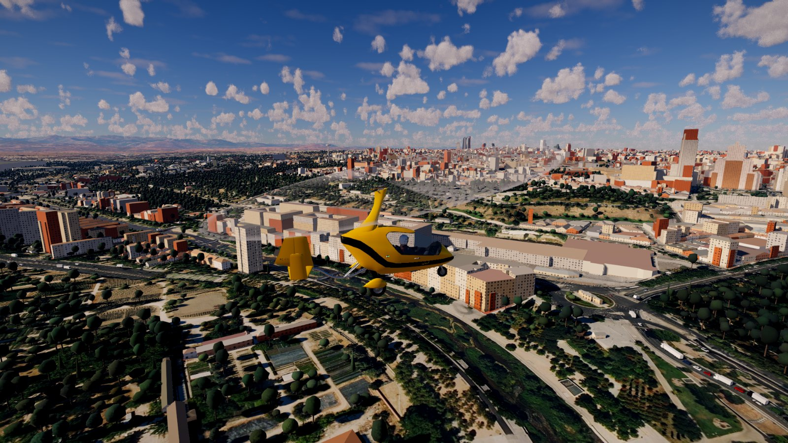</td>
    <td width="50%">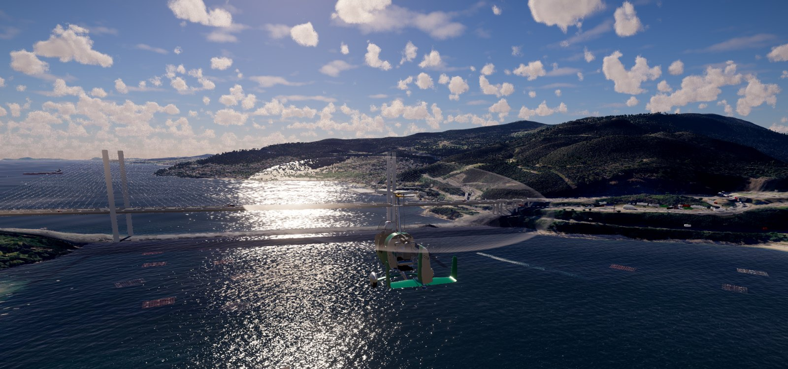</td>
  </tr>
  <tr>
    <td align="center">Madrid con sus edificios y tejados en 3D</td>
    <td align="center">El puente de Rande y la ría de Vigo, con el sol en el agua</td>
  </tr>
  <tr>
    <td width="50%"></td>
    <td width="50%">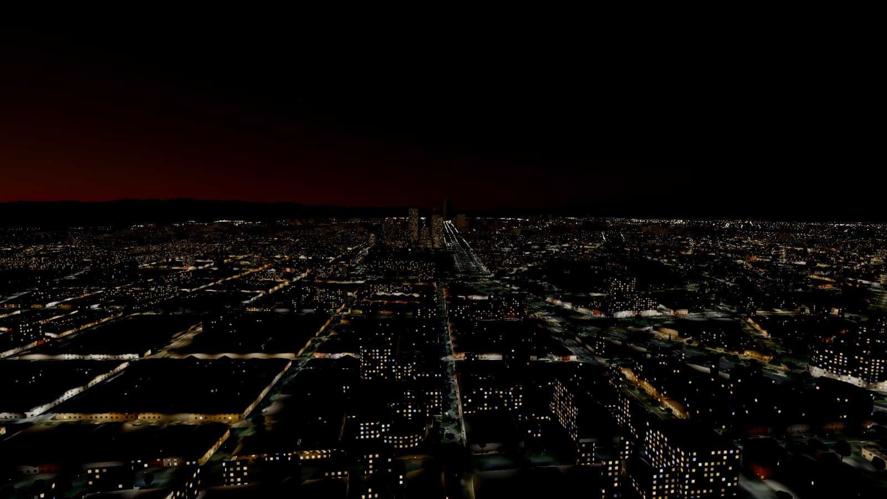</td>
  </tr>
  <tr>
    <td align="center">Tráfico en la Castellana: coches, furgonetas y tráileres</td>
    <td align="center">Madrid al anochecer: farolas, ventanas y faros encendidos</td>
  </tr>
  <tr>
    <td width="50%">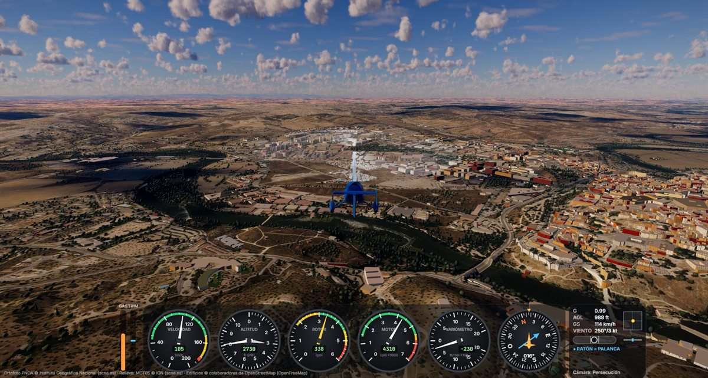</td>
    <td width="50%">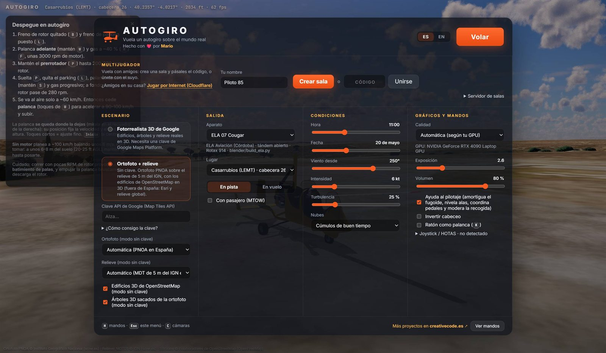</td>
  </tr>
  <tr>
    <td align="center">Relojes de rotor, motor, velocidad y variómetro</td>
    <td align="center">El menú: aparato, salida, hora y meteo, escenario y multijugador</td>
  </tr>
</table>

## Los aparatos

<table>
  <tr>
    <td width="50%">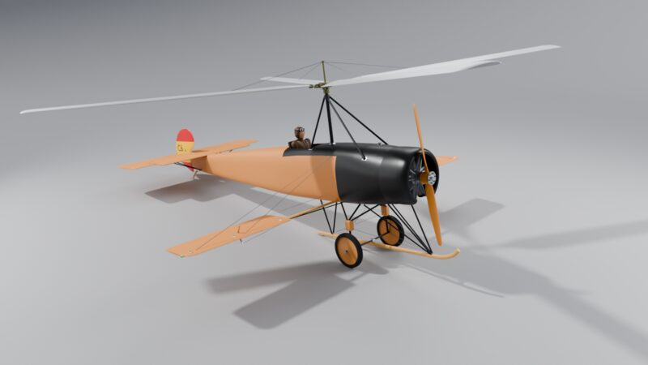</td>
    <td width="50%">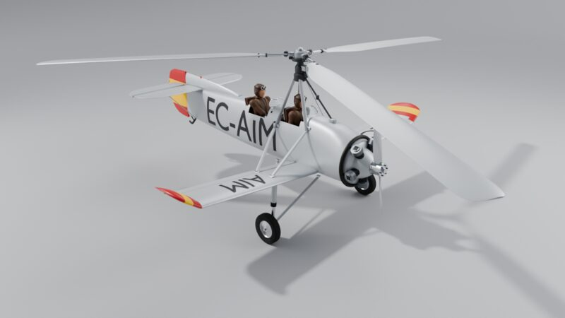</td>
  </tr>
  <tr>
    <td><b>Cierva C.6bis (1925)</b> · el primer autogiro que voló en Inglaterra, sobre un fuselaje de Avro 504K con motor rotativo Le Rhône. Sin prerrotador: pulsas <kbd>P</kbd> y el personal de tierra tira de la cuerda para lanzar el rotor. Cabeza fija: se gobierna con alerones, profundidad y timón.</td>
    <td><b>Cierva C.19 Mk IV (1932)</b> · el único C.19 que se conserva, el EC-AIM del Museo del Aire: rotor tripala que se lanza con un embrague desde el motor, cabeza fija y ala con alerones.</td>
  </tr>
  <tr>
    <td width="50%"></td>
    <td width="50%">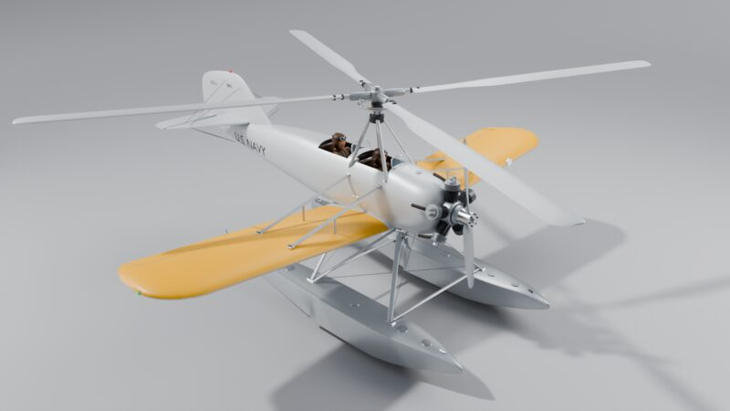</td>
  </tr>
  <tr>
    <td><b>Cierva C.30A (1934)</b> · homenaje a Juan de la Cierva, con hélice delante, rotor
    tripala, radial de 7 cilindros y rueda de cola. Se vuela como entonces.</td>
    <td><b>Wilford XOZ-1 (1936)</b> · el hidroautogiro de pruebas de la US Navy, sobre dos flotadores Edo: rotor de cuatro palas de paso cíclico, ala baja con alerones y radial Kinner de 155 CV. Sale del agua y amariza.</td>
  </tr>
  <tr>
    <td width="50%"></td>
    <td width="50%"></td>
  </tr>
  <tr>
    <td><b>Wallis WA-116 Agile (1961)</b> · el monoplaza diminuto de Ken Wallis, hermano de «Little Nellie», con un motor de dos tiempos de 72 CV.</td>
    <td><b>Sport Copter Lightning</b> · ultraligero monoplaza de bastidor abierto, con un Rotax 503 de dos tiempos.</td>
  </tr>
  <tr>
    <td width="50%"></td>
    <td width="50%"></td>
  </tr>
  <tr>
    <td><b>Sport Copter Lightning carenado</b> · el mismo monoplaza con morro, parabrisas y techo.</td>
    <td><b>AutoGyro MT-03</b> · el tándem abierto alemán que popularizó el autogiro moderno, Rotax 912.</td>
  </tr>
  <tr>
    <td width="50%"></td>
    <td width="50%"></td>
  </tr>
  <tr>
    <td><b>ELA 07 Cougar</b> · tándem abierto de ELA Aviación (Córdoba), Rotax 912 ULS.</td>
    <td><b>ELA 07 Scorpion</b> · el ELA 07 deportivo: motor carenado, dos parabrisas y cola alta, Rotax 914.</td>
  </tr>
  <tr>
    <td width="50%"></td>
    <td width="50%"></td>
  </tr>
  <tr>
    <td><b>Biplaza tándem</b> · el clásico de escuela tipo MTOsport, Rotax 912.</td>
    <td><b>AutoGyro Calidus</b> · cabina cerrada en tándem, fina y rápida, Rotax 914 turbo.</td>
  </tr>
  <tr>
    <td width="50%">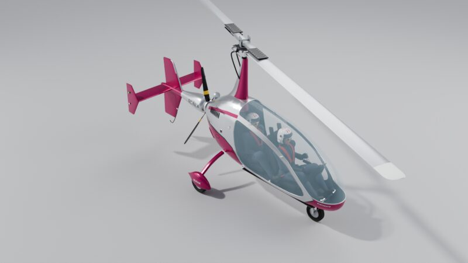</td>
    <td width="50%"></td>
  </tr>
  <tr>
    <td><b>Niki Lightning</b> · búlgaro, con la hélice en medio del aparato, girando alrededor del tubo de cola.</td>
    <td><b>AutoGyro Cavalon</b> · cabina cerrada con los dos asientos lado a lado; el piloto va a la derecha.</td>
  </tr>
  <tr>
    <td width="50%"></td>
    <td width="50%"></td>
  </tr>
  <tr>
    <td><b>DTA J-RO</b> · tándem cerrado francés de carbono, con puertas de ala de gaviota y tres derivas.</td>
    <td><b>ELA 10 Eclipse</b> · cabina cerrada y estilizada, el más rápido, Rotax 914 turbo.</td>
  </tr>
  <tr>
    <td width="50%">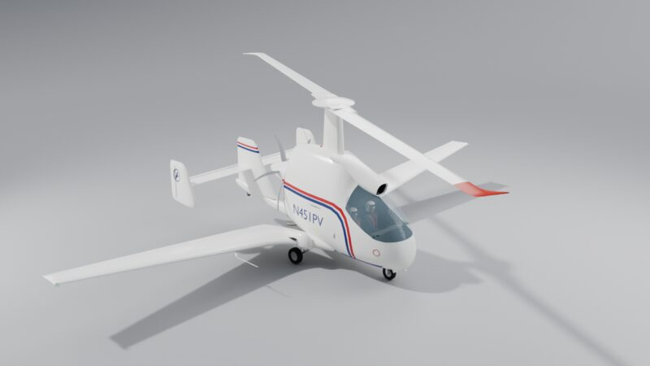</td>
    <td width="50%">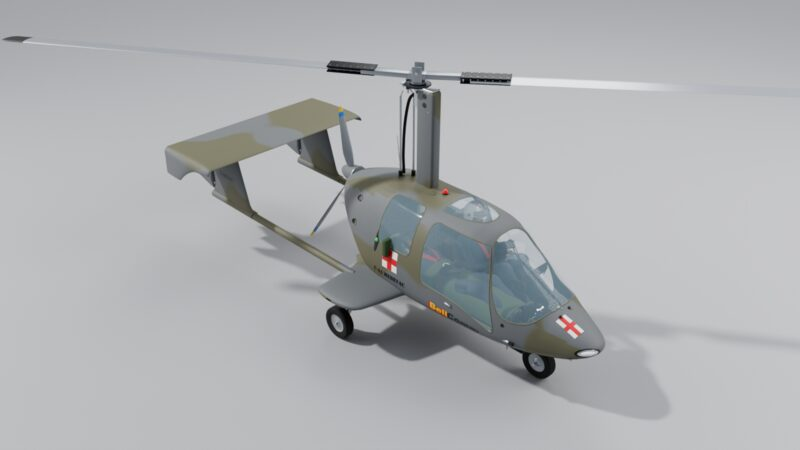</td>
  </tr>
  <tr>
    <td><b>Carter PAV</b> · compuesto de rotor lento con alas de 13,7 m: despega de un salto y, a 250 km/h, el rotor gira a poco más de 100 rpm.</td>
    <td><b>BellComm C-44 MEDEVAC</b> · autogiro ambulancia militar con camuflaje, sobre el Celier Xenon IV: cabina cerrada, dos vigas de cola y Rotax 912 turbo. El pasajero va tumbado en la camilla.</td>
  </tr>
  <tr>
    <td width="50%"></td>
    <td width="50%">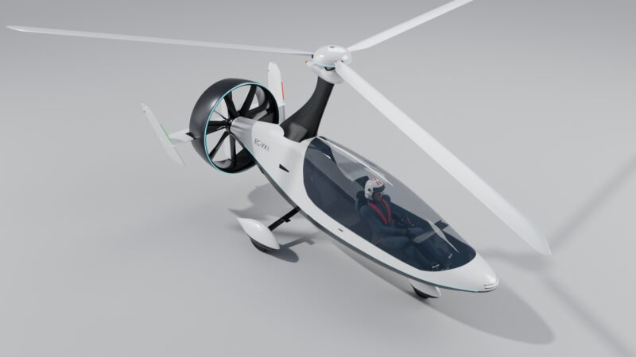</td>
  </tr>
  <tr>
    <td><b>ELA Gyro Tractor</b> · el fumigador de ELA: tolva de 200 l y barras de 8,25 m. Con la tecla <kbd>U</kbd> fumiga pasadas de 15 m y se va aligerando.</td>
    <td><b>Vencejo X1</b> · un futurista inventado para el juego: cúpula de una pieza, rotor tripala y hélice carenada.</td>
  </tr>
  <tr>
    <td width="50%">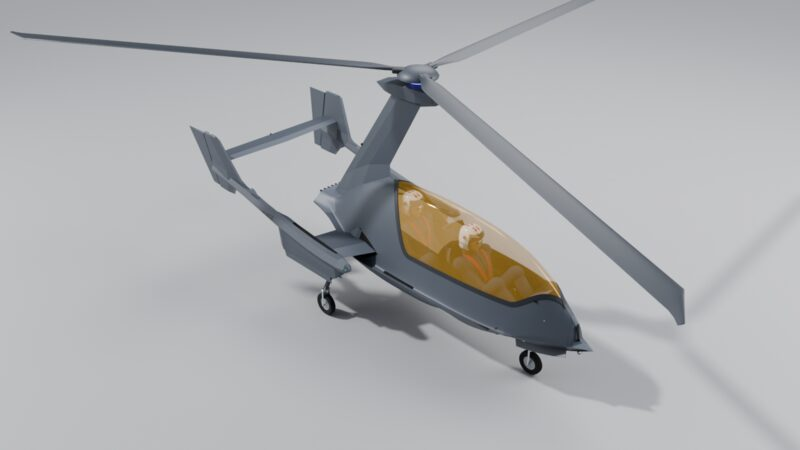</td>
    <td width="50%"></td>
  </tr>
  <tr>
    <td><b>Sigilo SX-1</b> · otro inventado, furtivo: cabina de caras planas, dos vigas hasta una cola alta e impulsor de plasma de ficción que brilla con el gas.</td>
    <td></td>
  </tr>
</table>

Todos menos los monoplazas (Sport Copter, Gyro Tractor, WA-116 y Cierva C.6bis) se pueden llevar solos o con pasajero, y cada uno tiene sus pesos, su motor, su rotor y su
cola: no vuelan igual.

**Con flotadores.** Los aparatos que han volado de verdad con flotadores tienen la opción en el menú: el
Cavalon (el «Cavalon Amphib» de AutoGyro) y el MT-03 (con el juego anfibio de la casa). Flotan, navegan
con los timones de agua, despegan corriendo sobre el redán y llevan ruedas que suben y bajan con la tecla
<kbd>Y</kbd>: arriba para el agua, abajo para tomar en tierra (con ellas fuera, en el agua vuelca). El
Wilford los lleva de serie y no tiene ruedas. En el menú, «Salida» tiene salidas posadas en el agua: el Mar
Menor, el embalse de San Juan, la bahía de Palma, el lago de Sanabria, Lake Hood (Alaska), el puerto de
Vancouver, el lago de Como y la laguna de Malé.

## Instalar

### Windows

1. **[Descarga el instalador](https://github.com/Marius-Romanus/autogiro/releases/latest/download/Autogiro-Setup.exe)**
   (unos 20 MB) y ábrelo.
2. La primera vez Windows puede avisar con *«Windows protegió su PC»* porque el instalador no está
   firmado: pulsa **Más información → Ejecutar de todas formas**.
3. Se instala solo, sin permisos de administrador, y crea el acceso directo en el escritorio.

### Linux

1. **[Descarga el AppImage](https://github.com/Marius-Romanus/autogiro/releases/latest/download/Autogiro-Linux.AppImage)**
   (unos 125 MB), que vale para cualquier distribución.
2. Dale permiso de ejecución: *clic derecho → Propiedades → Permitir ejecutar como programa*, o en
   la terminal `chmod +x Autogiro-Linux.AppImage`.
3. Ábrelo con doble clic. No hace falta instalar nada más.

Si prefieres un paquete de tu distribución, también está en
**[.deb](https://github.com/Marius-Romanus/autogiro/releases/latest/download/Autogiro-Linux.deb)**
(Ubuntu, Debian, Mint…) y
**[.rpm](https://github.com/Marius-Romanus/autogiro/releases/latest/download/Autogiro-Linux.rpm)**
(Fedora, openSUSE…); esos piden tu contraseña al instalarse y al actualizarse.

Cuando salga una versión nueva, el juego te lo dirá al abrirlo y se actualizará con un clic.

**Qué necesitas:** Windows 10 u 11 o un Linux de 64 bits reciente (Ubuntu 22.04, Debian 12,
Fedora 36 o más nuevos), conexión a Internet (el paisaje se descarga mientras vuelas) y, mejor, una
tarjeta gráfica dedicada. El juego elige la calidad solo; puedes cambiarla en el menú (*Ajustes →
Gráficos → Calidad*). En Windows usa siempre la gráfica potente del portátil. **F11** pone la
pantalla completa.

## Tu primer vuelo

1. Quita el **freno de rotor** (`B`) y suelta el **freno de parking** (`O`).
2. **Palanca adelante** (mantén `W`) y **gas al 40 %** (`R`), unas 3000 rpm de motor.
3. Mantén el **prerrotador** (`P`) hasta que el rotor llegue a **200–220 rpm**.
4. A la vez: suelta el prerrotador, **palanca toda atrás** (mantén `S`) y **gas a fondo**.
5. El rotor se embala con la velocidad y se va al aire a unos **70–80 km/h**. Entonces cede
   palanca para acelerar a 90–100 km/h pegado al suelo, y sube.

Para tomar: aproximación a 80–90 km/h y, a unos 6–8 m del suelo, tira de palanca y mantenla
(sale el aviso «RECOGIDA»). Con `H` tienes la ayuda en pantalla en cualquier momento.

## Cómo se vuela (y por qué es distinto)

- **Palanca = velocidad, gas = altura.** La palanca inclina el disco del rotor; el gas te sube o te baja.
- **Sin motor no pasa nada**: el rotor sigue girando y planeas a ~100 km/h bajando unos 6 m/s.
  Con la palanca toda atrás bajas casi en vertical, estable pero demasiado deprisa para tomar.
- **Batimiento de palas:** correr deprisa con pocas vueltas de rotor hace que la pala que avanza
  bata contra los topes. Accidente.
- **Baja carga:** empujar la palanca de golpe descarga el rotor, pierde vueltas y puedes perder el
  control. Mantén siempre carga positiva.
- Vigila el **tacómetro del rotor** (amarillo = prerrotación, verde = vuelo) y, en cabina, el
  **hilo de guiñada** del parabrisas.
- **Calor y altura.** La temperatura y el QNH del menú cambian la densidad del aire, y con ella el
  rotor, la hélice y el motor. Un día de agosto a 38 °C en Casarrubios es como despegar a 1500 m:
  la carrera se alarga un 20 %, para pasar 15 m hace falta casi un 40 % más de pista y se sube un
  20 % peor (los turbo, como el Rotax 914, pierden bastante menos). El plan de vuelo te dice la
  **altitud de densidad** de la salida. El anemómetro marca velocidad indicada, así que despegas y
  tomas a las mismas cifras aunque vayas más deprisa respecto al suelo; y el altímetro, calado al
  QNH, marca algo menos de lo que vuelas cuando hace calor (y más cuando hace frío).
- **Combustible.** Eliges en el menú con cuánto sales (lleno de serie) y cuenta en el peso: con el
  depósito lleno y pasajero, algún aparato pasa del máximo y el menú te lo dice. El depósito baja
  según la potencia que pidas (un Rotax 912 gasta unos 18 l/h al 75 %), el aparato se aligera, el
  indicador del panel y el del HUD lo marcan y se enciende la luz de **reserva**. Si se acaba, el
  motor falla a tirones y se para.
- **Fallos de motor.** Con `F2`, el **simulacro de la escuela**: el instructor te quita el gas a
  ralentí y no te lo devuelve hasta que termines (otra vez `F2`, «motor y al aire») o tomes tierra.
  En el menú puedes pedir que llegue cuando menos lo esperes, o elegir **fallos reales**: parada,
  pérdida de potencia, tirones, presión de aceite que acaba en gripaje si sigues volando con gas, y
  **hielo en el carburador** en los motores con carburador cuando el aire está húmedo. La guía
  lateral pasa a la emergencia con las cifras de tu aparato: velocidad de mejor planeo, campo cara
  al viento, virajes suaves y la altura a la que recoger.
- **El viento entiende el terreno.** El viento del menú es el de la manga del aeródromo; a partir
  de ahí cada sitio tiene el suyo. Las laderas de barlovento **suben** y las de sotavento bajan y
  zarandean; sobre las cumbres el viento aprieta. En la toma con viento cruzado, al pasar tras los
  **hangares** o una arboleda el viento afloja de golpe y vuelve al salir de su abrigo. De día, con
  sol, hay **térmicas** (más fuertes en verano y sobre campos secos, ninguna sobre el agua ni de
  noche) que derivan con el viento; de noche el aire se calma abajo y el viento crece y gira deprisa
  al subir. Sobre el mar sopla más y más liso que sobre una ciudad. En una sala, todos encontráis
  las mismas térmicas en el mismo sitio. Se puede apagar en *Hora y meteo*.

## Mandos

| Tecla | Acción |
|---|---|
| `W` `S` / `↑` `↓` | Palanca adelante / atrás. **Se queda donde la dejas**; `Inicio` la centra |
| `A` `D` / `←` `→` | Palanca izquierda / derecha |
| `Q` `E` | Pedales (timón y rueda de morro) |
| `R` `F`, `1`…`0` | Gas |
| `T` `G` | Compensador |
| `P` (mantener) | Prerrotador |
| `B` | Freno de rotor |
| `Espacio` / `O` | Frenos / freno de parking |
| `M` | Arrancar o parar el motor |
| `F2` | Simulacro de fallo de motor (el instructor quita gas) o, con fallos reales, un fallo |
| `L` | Luces |
| `U` | Fumigar (Gyro Tractor) |
| `Y` | Tren anfibio arriba o abajo (con flotadores anfibios) |
| `J` | Guía de pilotaje lateral (despegue, vuelo y aterrizaje); también con el botón «Guía» |
| `C` / `V` | Cambiar de cámara / mirar atrás |
| Ratón (arrastrar, rueda) | Mirar, zoom |
| `K` | Ratón como palanca |
| `Intro` | Chat (en multijugador) |
| `º` (mantener) | Hablar por la radio (en multijugador, con la radio activada; la tecla a la izquierda del 1) |
| `I` / `H` / `Esc` / `Retroceso` | Instrumentos / ayuda / menú / reiniciar |
| `F3` | Telemetría de rendimiento (FPS, CPU, GPU y memoria) |
| `F8` | Realidad virtual: recentrar la vista |
| `F4` | Repetición del vuelo (al salir, `Espacio` para seguir volando) |
| En la repetición | `Espacio` pausa · `←` `→` saltar 5 s · `,` `.` fotograma a fotograma · `↑` `↓` velocidad · `J` cámara lenta · `C` cámara · `B` ocultar la barra · `Esc` salir |
| `F11` | Pantalla completa |

**Mando tipo Xbox:** stick izquierdo = palanca, stick derecho = pedales, gatillos = gas,
A = prerrotador, B = frenos, X = radio (mantener). **Joystick o HOTAS:** los ejes y el botón de radio se
configuran en el menú y se ven en vivo.

La **ayuda al pilotaje** (activada de serie) hace con la mano lo que un piloto hace sin pensar:
amortigua las oscilaciones de cabeceo, nivela las alas y modera la recogida al tomar. No cambia la
física. Desactívala en el menú para volar al 100 % a mano.

## Realidad virtual

Con un visor de realidad virtual puedes volar sentado en la cabina, mirando alrededor con la cabeza.

- **Qué hace falta:** Windows, un visor con su programa abierto (SteamVR, Meta Link, etc.) y el juego en **Chrome o Edge**. Si usas la app de escritorio, en Ajustes tienes un botón que abre el mismo juego en el navegador.
- **Cómo se entra:** en **Ajustes › Gráficos** activa «Realidad virtual». Si encuentra el visor, durante el vuelo aparece el botón **VR** en la barra de arriba. Sin visor no cambia nada.
- **Con el visor puesto:** `F8` recentra la vista, `I` enseña u oculta la tablilla de avisos (alarmas, radio, guía y escuela, abajo a la izquierda) y `Esc` sale. Los relojes son los de la cabina.
- **Mandos:** teclado, joystick, HOTAS y mando de consola funcionan igual. Con los mandos del visor: palanca en la palanquita derecha, pedales y gas en la izquierda, freno en el gatillo izquierdo, prerrotador en el agarre derecho y radio en el gatillo derecho.
- **Fluidez:** «Detalle en el visor» tiene tres niveles. «Equilibrado» rinde como la pantalla normal; «Fluido» va más suelto; «Completo» lo dibuja todo como en pantalla y necesita un equipo muy potente. Si va justo, quita el tráfico aéreo.
- El menú, el mapa y la repetición se usan en la pantalla: al abrirlos se sale del visor.
- **Si en el navegador faltan los edificios, el agua o la foto del terreno**, casi siempre es un bloqueador de anuncios o de rastreo (Adblock Plus, uBlock Origin, Privacy Badger…): añade la página a sus excepciones y recarga. El juego te avisa arriba de qué no está cargando. En la app de escritorio no pasa.

Es una función nueva y todavía no está probada con todos los visores.

## Volar con amigos

En el menú, **Multijugador**: escribe tu nombre y pulsa **Crear sala**. Te da un código de
4 letras; tus amigos lo escriben y pulsan **Unirse**. Quien crea la sala elige el lugar, la hora y
el tiempo para todos, y cada uno su aparato.

- **En la misma wifi** entran directamente con la dirección que les indica el juego.
- **Por Internet**, el juego te explica paso a paso cómo abrir un túnel gratuito de Cloudflare
  (*Multijugador → Jugar por Internet*). Tus amigos pueden entrar incluso sin instalar nada, desde
  Chrome o Edge.

**Radio de voz.** Activa *Radio de voz* en la pestaña Multijugador (te pedirá el micrófono) y mantén
`º` o el botón de radio del mando para hablar; al soltar, el micro vuelve a quedar mudo. Suena como la
radio de un avión: banda estrecha, soplido y chasquido al abrir y cerrar, y si dos hablan a la vez se
pisan con un pitido. Mientras hablas no oyes a nadie. El alcance es el de la VHF real, por línea de
vista: en la pista os oís a unos pocos kilómetros, a 500 ft a decenas, con ruido al acercarte al límite,
y una montaña en medio corta la comunicación. Arriba ves quién habla y abajo, sobre los instrumentos,
*TX* mientras transmites. Volumen propio en *Ajustes → Sonido*.

## Escenario

| Modo | Qué ves | Necesita |
|---|---|---|
| **Ortofoto + relieve** (de serie) | En España, ortofoto PNOA y relieve de 5 m del IGN, edificios 3D de OpenStreetMap y del Catastro con tejados inclinados, y árboles 3D. Fuera de España, imágenes de satélite de Esri. En todo el mundo, mar, lagos y ríos con oleaje y reflejos, puentes y tendidos eléctricos en 3D, y tráfico por las calles. | Nada |
| **Fotorrealista 3D de Google** | Ciudades, árboles y montañas en 3D fotorrealista en todo el mundo. | Una clave gratuita de Google |

### Edificios y tejados

- **Tejados inclinados**: las casas y los bloques bajos llevan tejado a dos o cuatro aguas, los hangares
  de los aeródromos en bóveda y los cascos antiguos con faldones desde cada fachada. Los bloques altos y
  las naves industriales quedan con azotea plana. Donde nadie ha dicho cómo es el tejado, la forma se
  deduce de la planta: se parece a la realidad, pero no es una copia exacta.
- **Tejados de OpenStreetMap**: donde los voluntarios de OpenStreetMap han mapeado la forma del tejado
  sale tal cual: cúpulas, chapiteles, bulbos, minaretes, dos y cuatro aguas con su orientación… Los de
  España van con el juego; los del resto del mundo (casi 10 millones) se descargan solos por zonas de
  unos 150 km según por dónde vuelas, unos pocos MB cada una.
- **Edificios del Catastro** (España): muchas casas no están en OpenStreetMap, sobre todo en
  urbanizaciones y pueblos. El juego las completa con los edificios del Catastro, con su número real
  de plantas. Se descargan solos por municipios, los de alrededor y los que tienes por delante en el
  rumbo que llevas, de modo que al llegar ya están. Cada municipio se descarga una sola vez (entre 1 y 6 MB;
  Madrid capital, unos 120 MB, solo si vuelas por encima) y se queda guardado en tu ordenador: un pueblo
  ocupa unos cientos de kB y una ciudad como Móstoles, unos 3 MB.
  - *Menú → Escenario → Completar con el Catastro* lo activa o lo quita.
  - *Menú → Escenario → Datos del Catastro descargados* muestra cada municipio guardado y lo que ocupa,
    con un botón para borrarlo (o borrarlo todo).
  - País Vasco y Navarra tienen catastro propio y no están incluidos: allí se ven solo los de OpenStreetMap.

### Agua

El mar, los lagos, los embalses y los ríos de todo el mundo conservan el color que tienen en la foto (el
azul oscuro del mar abierto, el turquesa de un arrecife, el verde de un embalse) y encima llevan lo que
hace que el agua parezca agua: reflejan el cielo, más cuanto más a ras miras; el sol deja su camino de
destellos; y el oleaje sale del **viento que pongas en el menú**. En calma un lago es un espejo; con 10 nudos
el agua se riza a rachas; desde unos 12 nudos el mar saca borreguillos. Un piloto lee el viento en el agua,
y aquí también se puede.

Y se comporta como agua: si acabas en ella, el autogiro no se posa encima como en el suelo. Las ruedas se
clavan y lo vuelcan hacia delante si llegas con velocidad, las palas se parten al tocarla y la góndola flota
unos segundos mientras se llena antes de irse al fondo. Todo salpica: la corona de gotas del golpe, la
rociada, el cerco de espuma que se abre, la estela de lo que corre por el agua y las burbujas de lo que se
hunde. Volando bajo sobre el agua, el soplado del rotor levanta agua pulverizada.

### Tendidos eléctricos

Las líneas eléctricas de todo el mundo están en 3D: torres de celosía de alta tensión, apoyos de media
y postes de baja, cada uno con su forma según la tensión, y los cables colgando entre ellos. Se ven
como en vuelo: las torres desde lejos y los cables nítidos solo de cerca, cuando ya casi no da tiempo.
**Se choca con ellos**: un cable que entra en el disco del rotor parte las palas. Sirven también para
navegar, como en la realidad. En España salen de un fichero que va con el juego; fuera, de OpenInfraMap.
Las de teléfono casi no están en los mapas, así que apenas aparecen.
*Menú → Escenario → Tendidos eléctricos* los quita o los pone, también a mitad de vuelo.

### Puentes

Los puentes de OpenStreetMap de todo el mundo están en 3D, con su tablero a la altura de los estribos,
sus pilas y, según el tipo, sus arcos, celosías, tirantes o cables colgantes (el tipo sale de
Wikidata). Se puede pasar por debajo, posarse y rodar por el tablero o, si no calculas bien, chocar con
ellos. Donde el relieve trae el puente como si fuera un dique, el terreno se rebaja por debajo para que
pase el río; también en los muy altos, como el de la Constitución de 1812 en Cádiz, que sube limpio
hasta sus 70 m sobre la bahía. El Tower Bridge de Londres tiene su forma de verdad: torres góticas con
sus pináculos, pasarelas altas, básculas y tramos colgantes. Van con los *Edificios 3D* del menú.

### Mangas de viento

Los aeródromos tienen su manga de viento: las de OpenStreetMap donde las hay, la de Casarrubios en su
sitio, y en el resto una junto a la pista, fuera de la franja. Se llenan, se orientan y ondean con el
viento que hay en ese punto, rachas incluidas: cada franja llena son unos 3 kt y a 15 kt queda
horizontal, como las de verdad. De noche solo se ven iluminadas las de los aeródromos con vuelos
nocturnos.

### Tráfico y ciudades de noche

Por las carreteras y calles de OpenStreetMap de cualquier parte del mundo circulan coches, furgonetas,
camiones, tráileres y autobuses, por el lado que toca en cada país: van por su carril, ceden el paso,
entran en las rotondas, paran en los semáforos y no se atraviesan unos a otros. Hay trenes y tranvías,
con sus pasos a nivel, y ferris, barcos de recreo, pesqueros y mercantes en puertos, lagos y ríos. Es
tráfico simulado, no el real del momento, y cambia con la hora: en hora punta hay más. Se puede chocar
con ellos, así que ojo al tomar en un camino.

Al anochecer los vehículos encienden los faros, las farolas alumbran las calles urbanas y sus fachadas
(unas de sodio, naranjas, y otras LED, blancas) y se encienden las ventanas de los edificios: muchas hacia las
nueve de la noche y pocas de madrugada. *Menú → Escenario → Tráfico* quita los vehículos; las farolas
y las ventanas siguen.

### Tráfico aéreo en los aeródromos

En el aeródromo del que sales, y en los que tengas cerca, hay otros autogiros: aparcados en la
plataforma, rodando a la cabecera que toque según el viento, prerrotando, despegando y haciendo
circuitos con toma y despegue; unos llegan de fuera y otros se van. Vuelan con el mismo modelo de vuelo
que tú y se comportan como en un campo sin torre: nadie entra en pista si está ocupada o si viene
alguien en final, esperan en el punto de espera, alargan el viento en cola para dejar hueco y frustran
si hace falta. A ti te tratan como a uno más: si estás en la pista o en final, esperan o se van al
aire. Oirás sus motores al pasar y verás sus llamadas por radio («Casarrubios, EC-GK9, viento en cola
izquierda pista 26, para toma y despegue»). Solo vuelan de día y con buen tiempo, y se puede chocar con
ellos. *Menú → Escenario → Tráfico aéreo* lo quita o cambia cuánto hay; en las salas con amigos y en
los ejercicios de la escuela no sale.

<b>Cómo conseguir la clave de Google</b>

1. Entra en <https://console.cloud.google.com/> y crea un proyecto.
2. Activa la facturación (hay una cuota gratuita mensual generosa).
3. *APIs y servicios → Biblioteca* → habilita **Map Tiles API**.
4. *Credenciales → Crear credenciales → Clave de API*.
5. Pégala en el menú del juego. Se guarda solo en tu ordenador.

## Créditos

Creado por **Mario** · blog y otros proyectos en [creativecode.es](https://creativecode.es/) ·
si te gusta, [invítame a un café en Ko-fi](https://ko-fi.com/mario_creativecode) ☕

- Ortofoto PNOA y MDT05 © Instituto Geográfico Nacional ([scne.es](https://www.scne.es)), CC BY 4.0 ·
  imágenes Esri World Imagery · relieve global Mapzen / AWS Terrain Tiles · Google Photorealistic 3D Tiles © Google.
- Tendidos eléctricos © colaboradores de OpenStreetMap (ODbL): en España, del volcado de
  [Geofabrik](https://download.geofabrik.de); fuera, teselas de [Open Infrastructure Map](https://openinframap.org).
- Edificios, formas de tejado, agua (mar, lagos y ríos), puentes y las calles, vías y puertos del tráfico
  © colaboradores de OpenStreetMap (ODbL), teselas de [OpenFreeMap](https://openfreemap.org) / OpenMapTiles,
  y © [Dirección General del Catastro](https://www.catastro.hacienda.gob.es) (datos INSPIRE de edificios).
  Las formas de tejado de fuera de España llegan a través de [Overture Maps](https://overturemaps.org).
- Tipo de estructura de los puentes (colgante, atirantado, arco, celosía): [Wikidata](https://www.wikidata.org) (CC0).
- Mapa del mundo: aeródromos de [OurAirports](https://ourairports.com/data/) (dominio público), pistas y
  búsqueda de lugares © colaboradores de OpenStreetMap (OpenFreeMap y [Nominatim](https://nominatim.openstreetmap.org)).
- Tiempo real: datos meteorológicos de [Open-Meteo.com](https://open-meteo.com/)
  ([CC BY 4.0](https://creativecommons.org/licenses/by/4.0/deed.es)).
- [3d-tiles-renderer](https://github.com/NASA-AMMOS/3DTilesRendererJS) (NASA-AMMOS),
  [three-geospatial](https://github.com/takram-design-engineering/three-geospatial) (takram) para
  atmósfera y nubes, [Three.js](https://threejs.org), [Rapier](https://rapier.rs) y [Tauri](https://tauri.app),
  [straight-skeleton](https://github.com/StrandedKitty/straight-skeleton) (vHawk, MIT) para los tejados y
  [fflate](https://github.com/101arrowz/fflate) para descomprimir los datos del Catastro.
- Cierva C.30A: plano de tres vistas de *Flight* (1934) reproducido en la
  [NACA Aircraft Circular 196](https://ntrs.nasa.gov/citations/19930090361), datos de vuelo de los
  ensayos de la RAE (ARC R&M 1859 y 1727) y decoración de la réplica del Museo del Aire de Madrid.
- Wilford XOZ-1: ficha, fotos y plano de tres vistas de *Aero Digest* (febrero de 1935 y marzo de 1937),
  escaneados en el [Internet Archive](https://archive.org/details/aerodigest3019unse).
- Cierva C.6bis y C.19 Mk IV: planta del plano del hangar 4 del
  [Museo del Aire](https://ejercitodelaireydelespacio.defensa.gob.es/EA/museodelaire/hangar4.html), sus
  fichas y las de la Asociación de Amigos del Museo, *Flight* (1925 y 1931-1932) en el Internet Archive,
  P. W. Brooks, *Cierva Autogiros* (1988), el plano del Avro 504K y el de la
  [NACA Aircraft Circular 120](https://commons.wikimedia.org/wiki/Category:Cierva_C.19) (C.19 Mk III).
- BellComm C-44 MEDEVAC: hoja de datos de tipo del DAeC (Xenon IV CA-22), folletos de BellComm y de
  FlyArgo y fotos de Wikimedia Commons y de la prensa (defensa.com, fly-news.es).
- Flotadores del Cavalon y del MT-03: fotos del Cavalon Amphib C-FGYE y del MTOamphib de AutoGyro y el
  suplemento sueco del manual del MTOsport con flotadores.
- MT-03, Calidus, Cavalon, ELA 07 Cougar y Scorpion, ELA 10, ELA Gyro Tractor, J-RO, Niki Lightning, Sport Copter
  Lightning, Wallis WA-116 y Carter PAV:
  calcados sobre fotos de [Wikimedia Commons](https://commons.wikimedia.org) y de sus fabricantes, los
  manuales de vuelo de AutoGyro y DTA, las hojas de datos de la CAA británica y, para el Carter PAV, el
  artículo de Carter y Lewis en el European Rotorcraft Forum de 2015.

## Licencia

Autogiro es gratis para jugar, estudiar y modificar con cualquier fin **no comercial**: uso personal,
aficionados, clubes, escuelas y asociaciones sin ánimo de lucro. **No se permite venderlo ni usarlo para
ganar dinero** (tampoco versiones modificadas) sin permiso del autor. Si lo compartes o publicas una versión
modificada, tiene que ir con la licencia y el aviso de autoría: *Copyright (c) 2026 Mario (creativecode.es)*.
Texto completo en [LICENSE](LICENSE) ([PolyForm Noncommercial 1.0.0](https://polyformproject.org/licenses/noncommercial/1.0.0)).
Para un uso comercial, escríbeme a través de [creativecode.es](https://creativecode.es/).

---

  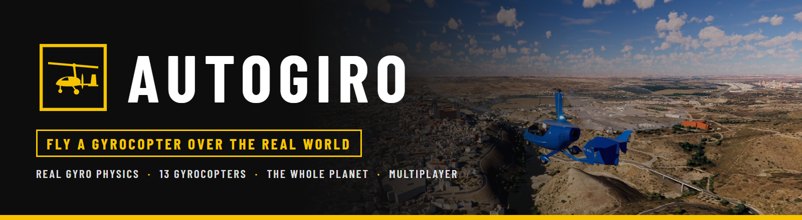

  <a href="#espanol"><b>Español</b></a> · <b>English</b>

  
  

  Free · Windows and Linux · in English and Spanish · updates itself ·
  <a href="https://github.com/Marius-Romanus/autogiro/releases">release notes</a> (in Spanish)

  Made with ❤️ by <a href="https://creativecode.es/"><b>Mario</b></a> · more projects at
  <a href="https://creativecode.es/"><b>creativecode.es</b></a> ·
  <a href="https://ko-fi.com/mario_creativecode">☕ buy me a coffee</a>

A simulator for anyone who wants to know how a real autogyro (gyrocopter, gyroplane) flies. Take off
from your airfield, fly over your town or the mountains you know, and learn why a gyro is flown neither
like an aeroplane nor like a helicopter.

- **Gyro physics, not an aeroplane with a propeller on top.** The rotor spins freely in
  autorotation, you have to pre-rotate it to take off, its RPM depends on the load, and it warns you
  about blade flapping and low-g. Performance has been checked against real data for each aircraft.
- **21 different gyrocopters.** Trainers, enclosed cabins, open-frame single-seaters, three by Juan
  de la Cierva (the 1925 C.6bis, the 1932 C.19 Mk IV and the 1934 C.30A), the BellComm C-44 MEDEVAC
  ambulance gyro, the US Navy's 1936 Wilford XOZ-1 seaplane gyro, the Wallis WA-116, a crop sprayer that
  really sprays (U key), the Carter PAV compound and two invented futuristic ones, one of them a stealth
  design, each with its own engine, rotor and physics. The Cavalon and the MT-03 can be fitted with the
  maker's amphibious floats to take off from and land on lakes and the sea.
- **The real world.** All over Spain you fly over the IGN's PNOA orthophotos and 5 m terrain model,
  with OpenStreetMap and Land Registry buildings with their roofs, and trees detected in the photo
  itself. Outside Spain you get Esri satellite imagery. All over the planet there are seas, lakes and
  rivers with waves and reflections, 3D bridges you can fly under and power lines you can crash into.
  With a Google key you can also use Google's photorealistic 3D anywhere on Earth.
- **Living cities.** Cars, vans, lorries and buses drive through the streets all over the world,
  keeping to their lanes, giving way and handling roundabouts and traffic lights; there are trains
  and trams, and ferries, pleasure boats, fishing boats and cargo ships in harbours, lakes and rivers.
  At dusk the street lights and the building windows light up.
- **A real sky.** Physical atmosphere, volumetric clouds with their shadows, any time and date,
  wind and turbulence, temperature and pressure (QNH), and night flying with navigation and landing
  lights. The **“Live weather”** button brings in the weather right now at your departure, wherever
  it is: wind and gusts, clouds, temperature, pressure, and its local time and date.
- **Bad-weather days.** Choose the visibility (tan dust haze or white humid haze, depending on how
  dry the air is), rain, showers or snow. With nearly saturated air, light wind and a clear sky,
  dawn brings fog over plains and valleys: climb out above a sea of cloud and watch it burn off
  as the sun warms up. Under an overcast, the dew point sets the stratus ceiling. Rain runs over
  the canopy in enclosed cabins, sounds different in an open one, wets the runway (a third less
  braking grip; less than half on snow), and above the snow line the hills turn white. The “Live
  weather” button brings all of it in as it is right now.
- **Start anywhere on the planet.** In the menu, “Pick on the world map” opens a globe you spin and
  zoom like in flight simulators: over 48,000 airfields worldwide with all their runways to take off
  from any threshold or start on final, a search box (ICAO, IATA, cities, mountains or coordinates)
  or just click anywhere and choose your heading, on the ground or in flight.
  Casarrubios (LEMT), Cuatro Vientos, Madrid-Barajas, Barcelona, Palma, Málaga, Seville, Valencia,
  Bilbao, Tenerife North and Gran Canaria also have ready-made starts (on the runway, on final or in
  the circuit).
- **Landmarks in Spain and around the world.** Over 170 in-flight starts: pick the country (with a
  search box) and then the place. At least
  one in every Spanish province (the Alhambra, the Sagrada Família, Santiago, Las Médulas,
  Gaztelugatxe, Mount Teide, Es Vedrà, Ceuta and Melilla…), and worldwide the Matterhorn,
  Mont-Saint-Michel, the Eiffel Tower, the Vatican, the Amalfi Coast, the Norwegian fjords, the
  Pyramids of Giza, the Taj Mahal, Mount Fuji, the Forbidden City, Ha Long Bay, New York, Las Vegas,
  the Grand Canyon, Machu Picchu, Iguazú, Patagonia, Bora Bora…
- **With friends.** Create a room, share the code and fly together, up to 8 pilots, with chat and voice radio.
- **Realistic crashes.** If you crash, the aircraft breaks apart piece by piece depending on the impacts.
- **Flight replay.** Press `F4` (or «Watch replay» after a crash) to watch the last 20 minutes again
  from any camera, in slow motion or sped up, with the instruments, the dust, the fire and every piece
  of the wreck. The «From the ground» camera puts you by the runway to watch your landing. And you can
  take the track home as **GPX** (time, altitude and speed) or **KML** to see it in Google Earth.
- **Flight school.** The “School” tab in the menu has ten exercises from a gyroplane pilot course, in
  order: taxiing and pre-rotation, wheel balancing on the main gear, a low hop along the runway, a full
  circuit, a precision landing, a power-off landing, an engine failure after take-off, crosswind, 360°
  turns and slow flight. You fly them at Casarrubios, with its real gyroplane circuit (south of the
  runway, 2500 ft) marked with gates in the air, or on any runway you pick on the map. At the end the
  instructor tells you whether you passed and what to fix, and the menu keeps your progress with each
  aircraft.
- **Every landing graded.** In free flight too: once you stop after a landing you see your vertical
  speed at touchdown, how fast you were, whether you touched on the main wheels or nose wheel first,
  the drift, how far you were from the centreline and the touchdown zone, the ground roll and the rotor
  rpm, with a grade from 0 to 10 and one specific tip for the next one. You can switch it off in the
  “School” tab.
- **Keyboard, mouse, gamepad or joystick/HOTAS**, with an optional flying assist so you can fly with
  the keyboard without fighting the phugoid.
- **In English and Spanish.** The game follows your computer's language, and you can switch it in the
  menu (`ES` / `EN` buttons at the top).

<table>
  <tr>
    <td width="50%"></td>
    <td width="50%"></td>
  </tr>
  <tr>
    <td align="center">Madrid with its 3D buildings and roofs</td>
    <td align="center">The Rande bridge over the Vigo estuary, with the sun on the water</td>
  </tr>
  <tr>
    <td width="50%"></td>
    <td width="50%"></td>
  </tr>
  <tr>
    <td align="center">Traffic on the Castellana: cars, vans and articulated lorries</td>
    <td align="center">Madrid at dusk: street lights, windows and headlights on</td>
  </tr>
  <tr>
    <td width="50%"></td>
    <td width="50%"></td>
  </tr>
  <tr>
    <td align="center">Rotor, engine, airspeed and vertical speed gauges</td>
    <td align="center">The menu: aircraft, departure, time and weather, scenery and multiplayer</td>
  </tr>
</table>

## The aircraft

<table>
  <tr>
    <td width="50%"></td>
    <td width="50%"></td>
  </tr>
  <tr>
    <td><b>Cierva C.6bis (1925)</b> · the first autogiro flown in England, built on an Avro 504K fuselage with a Le Rhône rotary engine. No prerotator: press <kbd>P</kbd> and the ground crew pull the rope to spin up the rotor. Fixed head: flown with ailerons, elevator and rudder.</td>
    <td><b>Cierva C.19 Mk IV (1932)</b> · the only surviving C.19, EC-AIM of the Museo del Aire: three-blade rotor spun up through a clutch from the engine, fixed head and a wing with ailerons.</td>
  </tr>
  <tr>
    <td width="50%"></td>
    <td width="50%"></td>
  </tr>
  <tr>
    <td><b>Cierva C.30A (1934)</b> · a tribute to Juan de la Cierva, the inventor of the autogyro:
    tractor propeller, three-blade rotor, 7-cylinder radial engine and tailwheel. You fly it the way
    it was flown back then.</td>
    <td><b>Wilford XOZ-1 (1936)</b> · the US Navy's test seaplane gyro on twin Edo floats: four-blade cyclic-pitch rotor, low wing with ailerons and a 155 hp Kinner radial. It takes off from and lands on water.</td>
  </tr>
  <tr>
    <td width="50%"></td>
    <td width="50%"></td>
  </tr>
  <tr>
    <td><b>Wallis WA-116 Agile (1961)</b> · Ken Wallis's tiny single-seater, sister of "Little Nellie", with a 72 hp two-stroke engine.</td>
    <td><b>Sport Copter Lightning</b> · open-frame single-seat ultralight with a two-stroke Rotax 503.</td>
  </tr>
  <tr>
    <td width="50%"></td>
    <td width="50%"></td>
  </tr>
  <tr>
    <td><b>Sport Copter Lightning (faired)</b> · the same single-seater with a nose pod, windscreen and roof.</td>
    <td><b>AutoGyro MT-03</b> · the German open tandem that made the modern gyroplane popular, Rotax 912.</td>
  </tr>
  <tr>
    <td width="50%"></td>
    <td width="50%"></td>
  </tr>
  <tr>
    <td><b>ELA 07 Cougar</b> · open tandem by ELA Aviación (Córdoba, Spain), Rotax 912 ULS.</td>
    <td><b>ELA 07 Scorpion</b> · the sporty ELA 07: cowled engine, two windscreens and a high tail, Rotax 914.</td>
  </tr>
  <tr>
    <td width="50%"></td>
    <td width="50%"></td>
  </tr>
  <tr>
    <td><b>Two-seat tandem</b> · the classic MTOsport-style trainer, Rotax 912.</td>
    <td><b>AutoGyro Calidus</b> · sleek, fast enclosed tandem, Rotax 914 turbo.</td>
  </tr>
  <tr>
    <td width="50%"></td>
    <td width="50%"></td>
  </tr>
  <tr>
    <td><b>Niki Lightning</b> · Bulgarian, with the propeller in the middle of the airframe, turning round the tail boom.</td>
    <td><b>AutoGyro Cavalon</b> · enclosed cabin with side-by-side seats; the pilot sits on the right.</td>
  </tr>
  <tr>
    <td width="50%"></td>
    <td width="50%"></td>
  </tr>
  <tr>
    <td><b>DTA J-RO</b> · French enclosed carbon tandem with gull-wing doors and three fins.</td>
    <td><b>ELA 10 Eclipse</b> · sleek enclosed cabin, the fastest one, Rotax 914 turbo.</td>
  </tr>
  <tr>
    <td width="50%"></td>
    <td width="50%"></td>
  </tr>
  <tr>
    <td><b>Carter PAV</b> · slowed-rotor compound with 13.7 m wings: it jumps off the ground and, at 250 km/h, its rotor turns at just over 100 rpm.</td>
    <td><b>BellComm C-44 MEDEVAC</b> · a camouflaged military ambulance gyro based on the Celier Xenon IV: enclosed cabin, twin tail booms and a turbo Rotax 912. The passenger lies on the stretcher.</td>
  </tr>
  <tr>
    <td width="50%"></td>
    <td width="50%"></td>
  </tr>
  <tr>
    <td><b>ELA Gyro Tractor</b> · ELA's crop sprayer: 200 l hopper and 8.25 m booms. Press <kbd>U</kbd> to spray 15 m swaths; it gets lighter as it goes.</td>
    <td><b>Vencejo X1</b> · a futuristic one invented for the game: one-piece canopy, three-blade rotor and ducted fan.</td>
  </tr>
  <tr>
    <td width="50%"></td>
    <td width="50%"></td>
  </tr>
  <tr>
    <td><b>Sigilo SX-1</b> · another invented one, a stealth design: faceted cabin, twin booms to a high tail and a fictional plasma drive that glows with the throttle.</td>
    <td></td>
  </tr>
</table>

All but the single-seaters (Sport Copter, Gyro Tractor, WA-116 and Cierva C.6bis) can be flown solo or with a passenger, and each one has its own weights, engine, rotor
and tail: they don't fly the same.

**On floats.** The types that really flew on floats have the option in the menu: the Cavalon (AutoGyro's
"Cavalon Amphib") and the MT-03 (with the maker's amphibious kit). They float, steer with water rudders,
take off running on the step and carry wheels that go up and down with the <kbd>Y</kbd> key: up for water,
down to land ashore (with them out, it flips on the water). The Wilford has floats as standard and no
wheels. Under "Departure" there are departures afloat: the Mar Menor, the San Juan reservoir, the Bay of
Palma, Lake Sanabria, Lake Hood (Alaska), Vancouver harbour, Lake Como and the Malé lagoon.

## Install

### Windows

1. **[Download the installer](https://github.com/Marius-Romanus/autogiro/releases/latest/download/Autogiro-Setup.exe)**
   (about 20 MB) and run it. It shows up in English or Spanish depending on your Windows.
2. The first time, Windows may show *“Windows protected your PC”* because the installer isn't signed:
   click **More info → Run anyway**.
3. It installs by itself, without administrator rights, and adds a shortcut to your desktop.

### Linux

1. **[Download the AppImage](https://github.com/Marius-Romanus/autogiro/releases/latest/download/Autogiro-Linux.AppImage)**
   (about 125 MB), which works on any distribution.
2. Make it executable: *right click → Properties → Allow executing as program*, or in a terminal
   `chmod +x Autogiro-Linux.AppImage`.
3. Double-click it. Nothing else to install.

If you'd rather use a package for your distribution, there are also
**[.deb](https://github.com/Marius-Romanus/autogiro/releases/latest/download/Autogiro-Linux.deb)**
(Ubuntu, Debian, Mint…) and
**[.rpm](https://github.com/Marius-Romanus/autogiro/releases/latest/download/Autogiro-Linux.rpm)**
(Fedora, openSUSE…) packages; those ask for your password when installing and updating.

When a new version comes out, the game tells you when you open it and updates with one click.

**You need:** Windows 10 or 11 or a recent 64-bit Linux (Ubuntu 22.04, Debian 12, Fedora 36 or
newer), an Internet connection (the scenery is downloaded as you fly) and, ideally, a dedicated
graphics card. The game picks the quality by itself; you can change it in the menu (*Settings →
Graphics → Quality*). On Windows it always uses the laptop's powerful GPU. **F11** toggles full
screen.

## Your first flight

1. Release the **rotor brake** (`B`) and the **parking brake** (`O`).
2. **Stick forward** (hold `W`) and **40 % throttle** (`R`), about 3000 engine rpm.
3. Hold the **pre-rotator** (`P`) until the rotor reaches **200–220 rpm**.
4. All at once: let go of the pre-rotator, **full back stick** (hold `S`) and **full throttle**.
5. The rotor speeds up as you gain speed and you lift off at about **70–80 km/h**. Then ease the
   stick forward to accelerate to 90–100 km/h close to the ground, and climb.

To land: approach at 80–90 km/h and, about 6–8 m above the ground, pull the stick back and hold it
(the “FLARE” warning appears). Press `H` for the on-screen help at any time.

## How to fly a gyro (and why it's different)

- **Stick = speed, throttle = height.** The stick tilts the rotor disc; the throttle makes you
  climb or descend.
- **No engine, no panic:** the rotor keeps turning and you glide at ~100 km/h, sinking about 6 m/s.
  With full back stick you come down almost vertically: stable, but too fast to land.
- **Blade flapping:** taxiing fast with low rotor RPM makes the advancing blade hit its stops. Crash.
- **Low-g:** pushing the stick forward abruptly unloads the rotor, it loses RPM and you can lose
  control. Always keep positive load.
- Keep an eye on the **rotor tachometer** (yellow = pre-rotation, green = flight) and, in the
  cockpit, on the **yaw string** on the windscreen.
- **Hot and high.** The temperature and QNH in the menu change the air density, and with it the
  rotor, the propeller and the engine. An August day at 38 °C at Casarrubios is like taking off at
  1500 m: the ground roll gets 20 % longer, you need almost 40 % more runway to clear 15 m and you
  climb 20 % worse (turbocharged engines such as the Rotax 914 lose much less). The flight plan shows
  the departure's **density altitude**. The airspeed indicator shows indicated airspeed, so you take
  off and land at the same numbers even though you're faster over the ground; and the altimeter, set
  to QNH, reads a little less than your real altitude when it's hot (and more when it's cold).
- **Fuel.** You choose in the menu how much you take off with (full by default) and it counts in the
  weight: with full tanks and a passenger some aircraft go over the maximum, and the menu tells you.
  The tank goes down with the power you use (a Rotax 912 burns about 18 l/h at 75 %), the aircraft
  gets lighter, the panel gauge and the HUD show it and the **low fuel** light comes on. If it runs
  dry, the engine stutters and stops.
- **Engine failures.** With `F2`, the **flying-school practice failure**: the instructor closes the
  throttle to idle and holds it until you end the exercise (`F2` again, go around) or land. In the
  menu you can have it come when you least expect it, or choose **real failures**: stoppage, power
  loss, rough running, oil pressure that ends in a seizure if you keep flying with power, and
  **carburettor ice** on carburetted engines when the air is humid. The side guide switches to the
  emergency with your aircraft's numbers: best-glide speed, a field into wind, gentle turns and the
  height to flare.
- **Wind that knows the terrain.** The wind you set in the menu is the one at the airfield windsock;
  from there every place has its own. Windward slopes **lift** you, lee slopes sink and shake you,
  and the wind squeezes over the summits. Landing in a crosswind, the wind drops suddenly as you
  pass behind the **hangars** or a line of trees and comes back when you leave their shelter. By
  day, in sunshine, there are **thermals** (stronger in summer and over dry fields, none over water
  or at night) drifting with the wind; at night the air goes calm near the ground and the wind grows
  and veers quickly as you climb. Over the sea it blows harder and smoother than over a town. In a
  room, everyone finds the same thermals in the same place. You can switch it off under *Time and
  weather*.

## Controls

| Key | Action |
|---|---|
| `W` `S` / `↑` `↓` | Stick forward / back. **It stays where you leave it**; `Home` centres it |
| `A` `D` / `←` `→` | Stick left / right |
| `Q` `E` | Pedals (rudder and nose wheel) |
| `R` `F`, `1`…`0` | Throttle |
| `T` `G` | Trim |
| `P` (hold) | Pre-rotator |
| `B` | Rotor brake |
| `Space` / `O` | Brakes / parking brake |
| `M` | Start or stop the engine |
| `F2` | Practice engine failure (the instructor closes the throttle) or, with real failures, a failure |
| `L` | Lights |
| `U` | Crop spraying (Gyro Tractor) |
| `Y` | Amphibious gear up or down (amphibious floats) |
| `J` | Side flying guide (takeoff, flight and landing); also the «Guide» button |
| `C` / `V` | Change camera / look back |
| Mouse (drag, wheel) | Look around, zoom |
| `K` | Mouse as stick |
| `Enter` | Chat (multiplayer) |
| `` ` `` (hold) | Talk on the radio (multiplayer, with the radio on; the key left of 1) |
| `I` / `H` / `Esc` / `Backspace` | Instruments / help / menu / restart |
| `F3` | Performance telemetry (FPS, CPU, GPU and memory) |
| `F8` | Virtual reality: recentre the view |
| `F4` | Flight replay (when you leave it, `Space` to keep flying) |
| In the replay | `Space` pause · `←` `→` skip 5 s · `,` `.` frame by frame · `↑` `↓` speed · `J` slow motion · `C` camera · `B` hide the bar · `Esc` exit |
| `F11` | Full screen |

**Xbox-style gamepad:** left stick = cyclic stick, right stick = pedals, triggers = throttle,
A = pre-rotator, B = brakes, X = radio (hold). **Joystick or HOTAS:** the axes and the radio button are
set up in the menu and shown live.

The **flying assist** (on by default) does with its hands what a pilot does without thinking: it
damps the pitch oscillations, levels the wings and moderates the flare when landing. It doesn't
change the physics. Turn it off in the menu to fly 100 % by hand.

## Virtual reality

With a VR headset you can fly sitting in the cockpit and look around with your head.

- **What you need:** Windows, a headset with its software running (SteamVR, Meta Link, etc.) and the game in **Chrome or Edge**. If you use the desktop app, Settings has a button that opens the same game in the browser.
- **How to enter:** turn on “Virtual reality” in **Settings › Graphics**. If the headset is found, a **VR** button appears on the top bar while flying. Without a headset nothing changes.
- **With the headset on:** `F8` recentres the view, `I` shows or hides the notice board (warnings, radio, guide and school, lower left) and `Esc` leaves. The gauges are the ones in the cockpit.
- **Controls:** keyboard, joystick, HOTAS and gamepad work as usual. With the headset controllers: stick on the right thumbstick, pedals and throttle on the left one, brake on the left trigger, pre-rotator on the right grip and radio on the right trigger.
- **Smoothness:** “Headset detail” has three levels. “Balanced” performs like the normal screen; “Smooth” is lighter; “Full” draws everything as on screen and needs a very powerful computer. If it struggles, turn off air traffic.
- The menu, the map and the replay are used on the screen: opening them leaves the headset.
- **If buildings, water or ground imagery are missing in the browser**, it's almost always an ad or tracker blocker (Adblock Plus, uBlock Origin, Privacy Badger…): add the page to its exceptions and reload. The game tells you at the top what isn't loading. The desktop app is not affected.

This is a new feature and has not been tested with every headset yet.

## Flying with friends

In the menu, **Multiplayer**: type your name and click **Create room**. You get a 4-letter code;
your friends type it and click **Join**. Whoever creates the room picks the place, time and weather
for everyone, and each pilot picks their own aircraft.

- **On the same Wi-Fi** they join straight away with the address the game shows them.
- **Over the Internet**, the game explains step by step how to open a free Cloudflare tunnel
  (*Multiplayer → Play over the Internet*). Your friends can even join without installing anything,
  from Chrome or Edge.

**Voice radio.** Turn on *Voice radio* in the Multiplayer tab (it asks for the microphone) and hold
`` ` `` or the radio button on your controller to talk; let go and the mic is muted again. It sounds like an
aircraft radio: narrow band, hiss and a squelch click when it opens and closes, and if two people talk
at once they step on each other with a whistle. While you talk you hear nobody. The range is real VHF
line of sight: on the runway you hear each other a few kilometres away, at 500 ft tens of kilometres,
with noise near the limit, and a mountain in between cuts you off. The pilot list shows who is talking
and a *TX* box above the instruments shows when you are transmitting. Its own volume is in
*Settings → Sound*.

## Scenery

| Mode | What you see | Needs |
|---|---|---|
| **Orthophoto + terrain** (default) | In Spain, PNOA orthophotos and the IGN 5 m terrain model, 3D buildings from OpenStreetMap and the Spanish Land Registry (Catastro) with pitched roofs, and 3D trees. Outside Spain, Esri satellite imagery. All over the world, seas, lakes and rivers with waves and reflections, 3D bridges and power lines, and traffic in the streets. | Nothing |
| **Google Photorealistic 3D** | Photorealistic 3D cities, trees and mountains all over the world. | A free Google key |

### Buildings and roofs

- **Pitched roofs**: houses and low-rise blocks get gable or hip roofs, airfield hangars get barrel
  roofs and old town centres get a roof slope from every façade. Tall blocks and industrial sheds keep a
  flat roof. Where nobody has described the roof, its shape is worked out from the footprint: it looks
  like the real thing, but it is not an exact copy.
- **OpenStreetMap roofs**: wherever OpenStreetMap volunteers have mapped the roof shape, that is what you
  get: domes, spires, onion domes, minarets, gable and hip roofs with their orientation… Spain's come
  with the game; the rest of the world's (almost 10 million) download by themselves in ~150 km zones
  wherever you fly, a few MB each.
- **Catastro buildings** (Spain): many houses are missing from OpenStreetMap, especially in housing
  estates and villages. The game fills them in with the Land Registry buildings, with their real number
  of floors. They are downloaded automatically by municipality, around you and ahead along your current
  heading, so they are ready when you get there. Each municipality is downloaded only once (1–6 MB;
  Madrid city, about 120 MB, only if you fly over it) and stays on your computer: a village takes a few
  hundred kB and a town like Móstoles about 3 MB.
  - *Menu → Scenery → Fill in with the Catastro* turns it on or off.
  - *Menu → Scenery → Downloaded Catastro data* lists every stored municipality and its size, with a
    button to delete it (or everything).
  - The Basque Country and Navarre have their own land registries and are not included: only
    OpenStreetMap buildings are shown there.

### Water

Seas, lakes, reservoirs and rivers all over the world keep the colour they have in the photo (the dark
blue of the open sea, the turquoise of a reef, the green of a reservoir) and add what makes water look
like water: they reflect the sky, the more the flatter you look; the sun leaves its trail of glints; and
the waves come from the **wind you set in the menu**. In calm air a lake is a mirror; at 10 knots the
water ripples in gusts; from about 12 knots the sea shows whitecaps. A pilot reads the wind on the
water, and you can do it here too.

And it behaves like water: if you end up in it, the gyroplane doesn't sit on top as on solid ground. The
wheels dig in and flip it forward if you arrive with speed, the blades break when they touch it, and the
pod floats for a few seconds while it fills before going to the bottom. Everything splashes: the crown of
droplets of the impact, the spray, the ring of foam that spreads, the wake of anything moving through the
water and the bubbles of what sinks. Flying low over water, the rotor downwash raises a ring of spray.

### Power lines

Power lines all over the world are in 3D: lattice towers for high voltage, medium-voltage poles and
low-voltage posts, each shaped by its voltage, with the wires sagging between them. They look as they
do in flight: the towers from far away and the wires sharp only up close, when there's hardly any time
left. **You can hit them**: a wire that gets into the rotor disc breaks the blades. They also help you
navigate, as in real life. In Spain they come from a file shipped with the game; elsewhere, from
OpenInfraMap. Telephone lines are barely mapped, so you'll rarely see them.
*Menu → Scenery → Power lines* turns them on or off, even in mid-flight.

### Bridges

OpenStreetMap bridges all over the world are in 3D, with their deck level with the abutments, their
piers and, depending on the type, their arches, trusses, stays or suspension cables (the type comes
from Wikidata). You can fly under them, land and taxi on the deck or, if you misjudge it, crash into
them. Where the terrain model has the bridge as if it were a dam, the ground underneath is carved out
so the river can pass; also on very tall ones, like the Constitución de 1812 bridge in Cádiz, which
now rises cleanly to its 70 m over the bay. London's Tower Bridge has its real shape: Gothic towers
with their pinnacles, high-level walkways, bascules and suspension side spans. They come with
*3D buildings* in the menu.

### Windsocks

Airfields have their windsock: OpenStreetMap's where there is one, Casarrubios' in its real spot, and
elsewhere one beside the runway, outside the strip. They fill, swing and flutter with the wind at
that very spot, gusts included: each filled stripe is about 3 kt and at 15 kt the sock stands
horizontal, like real ones. At night only those of airfields with night flights are lit.

### Traffic and cities at night

Cars, vans, lorries, articulated lorries and buses drive along the OpenStreetMap roads and streets
anywhere in the world, on the right side for each country: they keep to their lane, give way, enter
roundabouts, stop at traffic lights and never drive through each other. There are trains and trams,
with their level crossings, and ferries, pleasure boats, fishing boats and cargo ships in harbours,
lakes and rivers. It's simulated traffic, not the real
traffic of the moment, and it changes with the time of day: there's more at rush hour. You can crash
into them, so watch out when landing on a road.

At dusk the vehicles turn on their headlights, the street lights light up the urban streets and
their façades (some orange sodium, some white LED) and the building windows light up: lots of them around nine in the
evening and few in the small hours. *Menu → Scenery → Traffic* removes the vehicles; the street
lights and windows stay.

### Air traffic at the airfields

At the airfield you depart from, and at the ones nearby, there are other gyroplanes: parked on the
apron, taxiing to whichever runway end the wind calls for, pre-rotating, taking off and flying circuits
with touch-and-goes; some arrive from elsewhere and some leave. They fly on the same flight model as
you and behave as they would at an uncontrolled field: nobody enters the runway while it is occupied or
someone is on final, they wait at the holding point, extend downwind to make room and go around when
they have to. They treat you as one more pilot: if you are on the runway or on final, they wait or go
around. You'll hear their engines as they pass and see their radio calls. They only fly in daylight and
fair weather, and you can collide with them. *Menu → Scenery → Air traffic* turns it off or sets how
busy it is; it stays off in rooms with friends and during flight-school exercises.

<b>How to get the Google key</b>

1. Go to <https://console.cloud.google.com/> and create a project.
2. Enable billing (there is a generous free monthly quota).
3. *APIs & Services → Library* → enable the **Map Tiles API**.
4. *Credentials → Create credentials → API key*.
5. Paste it into the game menu. It is only stored on your computer.

## Credits

Created by **Mario** · blog and other projects at [creativecode.es](https://creativecode.es/) ·
if you like it, [buy me a coffee on Ko-fi](https://ko-fi.com/mario_creativecode) ☕

- PNOA orthophoto and MDT05 © Instituto Geográfico Nacional ([scne.es](https://www.scne.es)), CC BY 4.0 ·
  Esri World Imagery · global terrain Mapzen / AWS Terrain Tiles · Google Photorealistic 3D Tiles © Google.
- Power lines © OpenStreetMap contributors (ODbL): in Spain, from the [Geofabrik](https://download.geofabrik.de)
  extracts; elsewhere, tiles by [Open Infrastructure Map](https://openinframap.org).
- Buildings, roof shapes, water (seas, lakes and rivers), bridges and the streets, tracks and harbours
  of the traffic © OpenStreetMap contributors (ODbL), tiles by [OpenFreeMap](https://openfreemap.org) / OpenMapTiles,
  and © [Dirección General del Catastro](https://www.catastro.hacienda.gob.es) (INSPIRE building data).
  Roof shapes outside Spain come via [Overture Maps](https://overturemaps.org).
- Bridge structure types (suspension, cable-stayed, arch, truss): [Wikidata](https://www.wikidata.org) (CC0).
- World map: airfields from [OurAirports](https://ourairports.com/data/) (public domain), runways and
  place search © OpenStreetMap contributors (OpenFreeMap and [Nominatim](https://nominatim.openstreetmap.org)).
- Live weather: weather data by [Open-Meteo.com](https://open-meteo.com/)
  ([CC BY 4.0](https://creativecommons.org/licenses/by/4.0/)).
- [3d-tiles-renderer](https://github.com/NASA-AMMOS/3DTilesRendererJS) (NASA-AMMOS),
  [three-geospatial](https://github.com/takram-design-engineering/three-geospatial) (takram) for
  atmosphere and clouds, [Three.js](https://threejs.org), [Rapier](https://rapier.rs) and [Tauri](https://tauri.app),
  [straight-skeleton](https://github.com/StrandedKitty/straight-skeleton) (vHawk, MIT) for the roofs and
  [fflate](https://github.com/101arrowz/fflate) to unpack the Catastro data.
- Cierva C.30A: three-view drawing from *Flight* (1934) reproduced in
  [NACA Aircraft Circular 196](https://ntrs.nasa.gov/citations/19930090361), flight data from the RAE
  tests (ARC R&M 1859 and 1727) and colour scheme of the replica at the Museo del Aire in Madrid.
- Wilford XOZ-1: data sheet, photos and three-view from *Aero Digest* (February 1935 and March 1937),
  scanned at the [Internet Archive](https://archive.org/details/aerodigest3019unse).
- Cierva C.6bis and C.19 Mk IV: plan view from the hangar 4 drawing of the
  [Museo del Aire](https://ejercitodelaireydelespacio.defensa.gob.es/EA/museodelaire/hangar4.html), its
  sheets and those of the museum's friends' association, *Flight* (1925 and 1931-1932) at the Internet
  Archive, P. W. Brooks, *Cierva Autogiros* (1988), the Avro 504K drawing and the
  [NACA Aircraft Circular 120](https://commons.wikimedia.org/wiki/Category:Cierva_C.19) (C.19 Mk III).
- BellComm C-44 MEDEVAC: DAeC type data sheet (Xenon IV CA-22), BellComm and FlyArgo brochures, and
  photos from Wikimedia Commons and the press (defensa.com, fly-news.es).
- Cavalon and MT-03 floats: photos of AutoGyro's Cavalon Amphib C-FGYE and MTOamphib, and the Swedish
  MTOsport floats flight-manual supplement.
- MT-03, Calidus, Cavalon, ELA 07 Cougar and Scorpion, ELA 10, ELA Gyro Tractor, J-RO, Niki Lightning, Sport Copter
  Lightning, Wallis WA-116 and Carter PAV:
  traced on photos from [Wikimedia Commons](https://commons.wikimedia.org) and from their makers, the
  AutoGyro and DTA flight manuals, the UK CAA data sheets and, for the Carter PAV, the paper by Carter
  and Lewis at the 2015 European Rotorcraft Forum.

## License

Autogiro is free to play, study and modify for any **non-commercial** purpose: personal use, hobbyists,
clubs, schools and non-profits. **You may not sell it or use it to make money** (modified versions included)
without the author's permission. If you share it or publish a modified version, it must carry the license and
the copyright notice: *Copyright (c) 2026 Mario (creativecode.es)*.
Full text in [LICENSE](LICENSE) ([PolyForm Noncommercial 1.0.0](https://polyformproject.org/licenses/noncommercial/1.0.0)).
For commercial use, get in touch through [creativecode.es](https://creativecode.es/).
